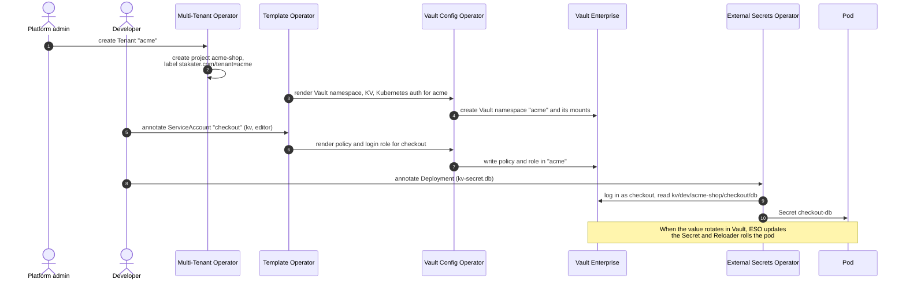
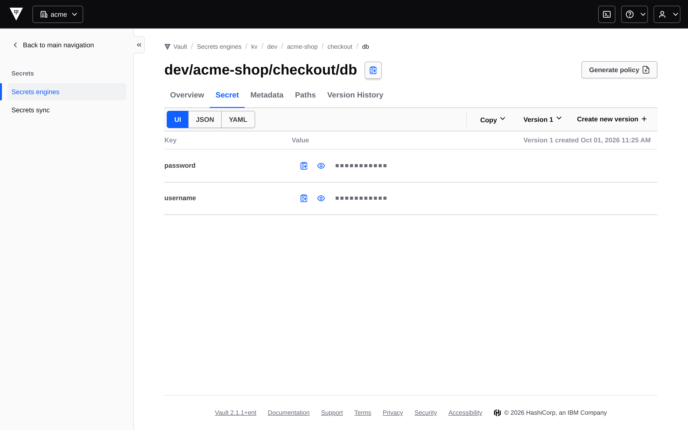

# One tenant, from OpenShift to Vault Enterprise

<!--
Outlet: Red Hat Developer (then the Stakater blog, canonical link back).
Rafael (Red Hat) validates the guide on his own cluster and submits the post.
Authors: Rafael (Red Hat), Rasheed Amir (Stakater), Aisha (Stakater). Byline order to agree.
Target: about 1,600 words. Reader: platform engineers running OpenShift and Vault.
Title options:
  - One tenant, from OpenShift to Vault Enterprise
  - Give every team its own Vault namespace on OpenShift, automatically
  - Multi-tenancy on OpenShift that reaches all the way into Vault
-->

Most OpenShift platforms reach the same point. The cluster is shared, dozens
of teams deploy to it, and every one of them needs secrets. Vault Enterprise
holds those secrets. But Vault doesn't know who your teams are, and OpenShift
doesn't tell it.

So the platform team fills the gap by hand. A new team arrives, someone opens
a ticket, and an engineer writes the Vault policies, the auth roles and the
paths for that team. The team adds a project, and the ticket comes back. Over
time, the configuration in Vault drifts away from the teams on the cluster,
and nobody can say for sure who can read what.

This post shows a different approach. You define the team once on the
cluster, as a **tenant**, and that boundary carries into Vault automatically,
all the way to the secret inside a running pod.

## A project is not a team

OpenShift projects isolate workloads well, but a team is usually more than one
project. A team has `dev`, `staging` and `prod`. It has members with different
roles. It may own five services across three projects. Projects don't record
any of that, so every tool that needs to know who a team is ends up keeping
its own list.

Multi-Tenant Operator, a Red Hat certified operator, adds that missing object.
A `Tenant` is the team. It names the owners and the projects, and Multi-Tenant
Operator keeps the cluster in line with it:

```yaml
apiVersion: tenantoperator.stakater.com/v1beta3
kind: Tenant
metadata:
  name: acme
spec:
  accessControl:
    owners:
      users:
        - anna@example.com
  namespaces:
    withTenantPrefix:
      - shop
```

Multi-Tenant Operator creates `acme-shop`, gives Anna access to it, and
labels it `stakater.com/tenant: acme`. That label matters: it is how every
other tool finds out which tenant a project belongs to.

## Every tenant becomes a Vault namespace

Vault Enterprise already has a construct built for tenancy: **Vault
namespaces**. Each Vault namespace has its own policies, auth methods and
secret engines, isolated from the others. It's the natural home for a tenant.
What's usually missing is the automation that keeps the Vault namespaces in
line with the teams.

The Vault Enterprise extension for Multi-Tenant Operator provides it. For
every tenant, it creates:

- a Vault namespace named after the tenant (`acme`)
- a KV secrets engine inside it
- a Kubernetes auth method inside it, so the tenant's workloads can log in
  with their own ServiceAccount tokens
- optionally, an OIDC login for people, mapped to identity-provider groups

When you add a tenant, a new Vault namespace appears. When you add a project
to a tenant, its workloads can use that tenant's Vault namespace, and no
other.

## How it works

No new controller writes to Vault. The extension combines open source
projects that are already in use in OpenShift shops:

| Component | Role |
|---|---|
| **Multi-Tenant Operator** | Owns the `Tenant` and labels the tenant's projects |
| **Template Operator** | Ships with Multi-Tenant Operator. Renders one set of Vault configuration resources per tenant |
| **Vault Config Operator** | Writes that configuration into Vault, declaratively |
| **External Secrets Operator** | Copies secrets from Vault into Kubernetes Secrets |
| **Reloader** | Rolls the pods when a secret changes |

### Vault configuration as Kubernetes resources

Vault Config Operator is the piece that makes this work without a single
hand-written Vault command per team. It's an open source project in the Red
Hat Community of Practice. It turns Vault configuration into Kubernetes
custom resources: a `Policy`, an `AuthEngineMount`, a
`KubernetesAuthEngineRole`, a `SecretEngineMount`, and even a Vault
`Namespace` itself.

That changes how a platform team runs Vault. The configuration lives in Git
and goes through review like any other manifest. It's applied by a
controller instead of a person with a root token. Vault Config Operator can
also check Vault against the resources and put back anything someone changed
by hand.

Until recently there was one gap for multi-tenancy. Vault Config Operator
wrote every object into the Vault namespace it had logged in to. Giving each
tenant its own Vault namespace would have meant a separate login, with its
own credentials, for every tenant.

Stakater closed that gap upstream. Version 1.0.3 adds
`spec.authentication.targetNamespace`, so Vault Config Operator logs in
**once** and writes each tenant's objects into that tenant's own Vault
namespace. The same release fixes the controller that creates Vault
namespaces, so they can be managed reliably as resources. The work went in
through the normal upstream review
([redhat-cop/vault-config-operator#373](https://github.com/redhat-cop/vault-config-operator/pull/373)),
and every Vault Config Operator user gets it, with or without Multi-Tenant
Operator.

Here's the flow from a new team to a running pod with its secret:



## What a developer does

Two annotations on the ServiceAccount ask for the app's own space in the
tenant's Vault namespace, and decide how much access it gets:

```yaml
apiVersion: v1
kind: ServiceAccount
metadata:
  name: checkout
  namespace: acme-shop
  annotations:
    vault.stakater.com/kv: "true"
    vault.stakater.com/tier: editor
```

One annotation on the Deployment asks for a secret:

```yaml
metadata:
  annotations:
    vault.stakater.com/kv-secret.db: db#password
    reloader.stakater.com/auto: "true"
```

That's all. The developer doesn't write a Vault policy, open a ticket or
handle a Vault token. The app's secrets live at
`kv/dev/acme-shop/checkout/`, External Secrets Operator delivers them as the
Secret `checkout-db`, and the app reads it the way it reads any other
Kubernetes Secret.

Teams that need to share do it explicitly. A project can publish values to
the other projects in its tenant. Two tenants can exchange values through a
separate shared Vault namespace. Both sides have to annotate, and every share
is read-only for the side that receives it.

## What people see

Engineers sign in to Vault with single sign-on. Each tenant has four tiers:
`viewer`, `editor`, `admin` and `audit-read`. Each tier maps to an
identity-provider group named by a pattern, such as `acme-editors`, so access
follows the groups your identity team already manages.

An editor sees the app's secrets and can write a new version:



A viewer sees the same keys, and can't write:


An auditor can list what exists, but can't read any value:


## Guardrails for Vault owners

Vault owners will ask what this setup can do to their Vault. The answers,
each covered by the extension's end-to-end tests on Vault Enterprise 2.1.1:

- **Isolation holds.** A workload can't read another app's secrets, another
  tenant's Vault namespace, or log in with another tenant's role. Vault
  refuses each attempt with a 403.
- **Vault stays in charge.** Workloads log in through Vault's own Kubernetes
  auth method, and people through Vault's own OIDC method. Nothing goes
  around Vault.
- **Drift is reverted.** If someone widens a policy by hand in Vault, Vault
  Config Operator rewrites it, and the extra access goes away.
- **Secrets survive mistakes.** With the recommended Vault policy, removing a
  tenant revokes its access but keeps its Vault namespace and data. Deleting
  the data stays a deliberate step for a Vault admin.

One rule matters most: the `stakater.com/tenant` label grants Vault access,
so only the platform should be able to set it on a project. Multi-Tenant
Operator already depends on the same rule.

## Try it

Multi-Tenant Operator's Basic edition is free with no expiry, and manages up
to two tenants. That's enough to see two teams isolated from each other in
Vault. You bring your own Vault Enterprise license, version 2.1 or later.

The companion tutorial,
[Hands-on: tenants on OpenShift, carried into Vault Enterprise](https://github.com/stakater/mto-blogs/tree/main/02-try-it-tenants-and-vault-enterprise),
takes you from an empty OpenShift cluster to an app reading its secret from
its tenant's own Vault namespace, in about an hour.

Transit and PKI engines aren't supported by the Vault Enterprise extension
yet. Today it covers KV secrets, workload login, single sign-on, sharing and
delivery through External Secrets Operator.

## What's next

The tenant you defined here doesn't stop at Vault. In the next posts in this
series, we'll carry the same boundary into more of the tools your teams use
every day.

---

*Rafael [surname], [role], Red Hat. Rasheed Amir, [role], Stakater.
Aisha [surname], [role], Stakater.*
