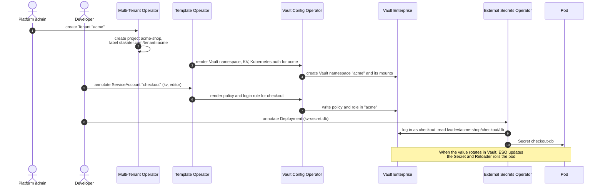
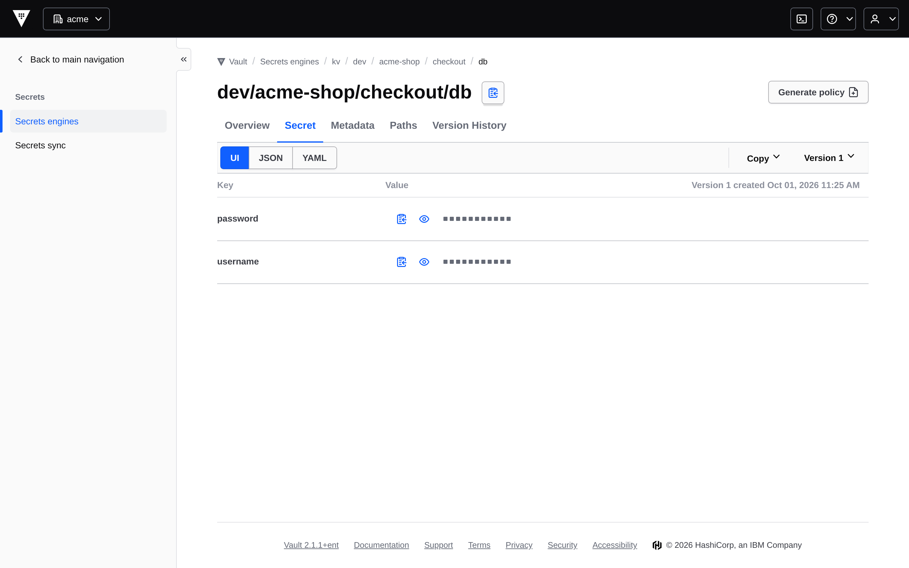
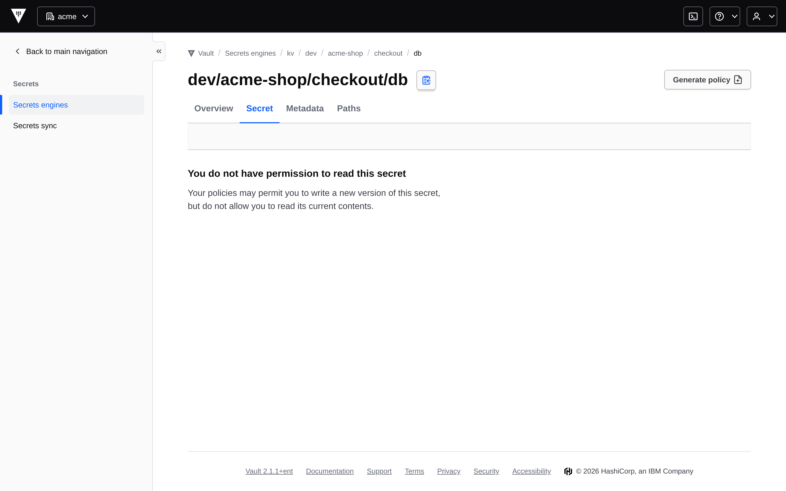

# One tenant, from OpenShift to Vault Enterprise

<!--
Outlet: Red Hat Developer (then the Stakater blog, canonical link back).
Authors: Ayesha Arshad (Stakater), Rasheed Amir (Stakater), Raffaele Spazzoli (Red Hat).
Target: about 2,000 words. Reader: platform engineers running OpenShift and Vault.
Title options:
  - One tenant, from OpenShift to Vault Enterprise
  - Give every team its own Vault namespace on OpenShift, automatically
  - Multi-tenancy on OpenShift that reaches all the way into Vault
-->

Every platform team running a shared OpenShift cluster meets the same
question sooner or later. Forty teams deploy to the cluster, and every one
of them needs secrets: database passwords, API keys, tokens. **How
does each team get its own secrets, and only its own, without the platform
team doing it by hand?**

On the cluster itself, the answer is well understood. OpenShift projects,
role-based access control, quotas and network policies keep workloads
apart. But the secrets usually live somewhere else, in HashiCorp Vault
Enterprise, because that's the system the security team trusts with them.
Vault has its own model for keeping things apart: Vault namespaces,
policies and auth methods. That model knows nothing about the teams on your
cluster.

So there are two systems, with two separate ideas of who a team is, and
nothing keeps them in step. In most organizations, that "nothing" is a
platform engineer working through a queue of tickets.

This article shows a different approach. You define each team once, on the
cluster, as a **tenant**. That one boundary is then carried into Vault
automatically. Every tenant gets its own Vault namespace. Its apps ask for
their secrets with an annotation, and its people sign in with their company
accounts, each seeing only their own team's secrets. And the Vault
configuration keeps up as teams change.

The tenant comes from **Multi-Tenant Operator**, a Red Hat certified
operator from Stakater. It's a commercial product, with a free Basic edition
that manages up to two tenants, with no expiry. The rest is open source
already in use in OpenShift shops: Vault Config Operator from the Red Hat
Community of Practice, External Secrets Operator and Reloader.

**In this article:**

- what onboarding a single team into Vault Enterprise takes today, and
  where that breaks down
- the tenant: a team as a first-class object on OpenShift
- how one tenant becomes one Vault namespace, with access for its apps and
  its people, and what's automated along the way
- how the pieces fit together
- the guardrails Vault owners will ask about

**Who it's for:** platform engineers and architects who run OpenShift with
Vault Enterprise, and the people who own Vault in those organizations. You
should be familiar with OpenShift projects and with Vault basics, such as
policies and auth methods. If Multi-Tenant Operator is new to you, this is
a good place to meet it: the article introduces it from the ground up.

**Want to build it?** The companion tutorial,
[Hands-on: tenants on OpenShift, carried into Vault Enterprise](https://github.com/stakater/mto-blogs/tree/main/02-try-it-tenants-and-vault-enterprise),
takes you through every step on your own cluster. This article explains the
why and the how, so you know what you're building.

## What one team costs in Vault

Here is what onboarding one team, with one app, looks like in Vault
Enterprise when it's done properly: the team gets its own Vault namespace,
the app gets its own path, and people sign in through the company's
identity provider. The commands are simplified, but every line is a real
step:

```bash
# A boundary for the team
vault namespace create acme
vault secrets enable -namespace=acme -path=kv kv-v2
vault auth enable    -namespace=acme -path=kubernetes/workloads kubernetes
vault write -namespace=acme auth/kubernetes/workloads/config \
  kubernetes_host=https://kubernetes.default.svc:443

# A policy and a login role for the app, limited to its own path
vault policy write -namespace=acme checkout-editor - <<'EOF'
path "kv/data/dev/acme-shop/checkout/*" { capabilities = ["create", "read", "update"] }
path "kv/metadata/dev/acme-shop/checkout/*" { capabilities = ["list", "read"] }
EOF
vault write -namespace=acme auth/kubernetes/workloads/role/checkout \
  bound_service_account_names=checkout \
  bound_service_account_namespaces=acme-shop \
  token_policies=checkout-editor

# Sign-in for people: an OIDC login, and a policy and role per access level
vault auth enable -namespace=acme -path=oidc/sso oidc
vault write -namespace=acme auth/oidc/sso/config oidc_discovery_url=... oidc_client_id=... oidc_client_secret=...
vault policy write -namespace=acme acme-editor ...
vault write -namespace=acme auth/oidc/sso/role/editor bound_claims='{"groups":["acme-editors"]}' token_policies=acme-editor ...
# ...and the same again for viewer, admin and audit-read
```

That's Vault. On the cluster, the app still needs a `SecretStore` and an
`ExternalSecret` before the secret reaches the pod.

Now multiply it. Every app in the team needs its own policy and role. Every
team needs the whole block. Then it has to be **kept** right: a new project
needs new bindings, an app that moves from editor to viewer needs its policy
rewritten, and a team that leaves needs every grant removed. Nothing in
Vault notices when the cluster changes.

Platform teams end up in one of three places:

- **One broad policy.** Quick to set up, and one leaked token reads every
  team's secrets.
- **A ticket per request.** Safe, and the platform team becomes the queue.
- **Kept by hand.** The quiet one. People and apps leave, and their access
  stays. It's the one that shows up in an audit.

## A project is not a team

OpenShift projects isolate workloads well, but a team is usually more than one
project. A team has `dev`, `staging` and `prod`. It has members with different
roles. It may own five services across three projects. Projects don't record
any of that, so every tool that needs to know who a team is ends up keeping
its own list.

Multi-Tenant Operator, a Red Hat certified operator, adds that missing object.
A `Tenant` is the team. It names the owners and the projects, and Multi-Tenant
Operator keeps the cluster in line with it:

```yaml
apiVersion: tenantoperator.stakater.com/v1beta3
kind: Tenant
metadata:
  name: acme
spec:
  accessControl:
    owners:
      users:
        - anna@example.com
  namespaces:
    withTenantPrefix:
      - shop
```

Multi-Tenant Operator creates `acme-shop`, gives Anna access to it, and
labels it `stakater.com/tenant: acme`. That label matters: it is how every
other tool finds out which tenant a project belongs to.

## Every tenant becomes a Vault namespace

Vault Enterprise already has a construct built for tenancy: **Vault
namespaces**. Each Vault namespace has its own policies, auth methods and
secret engines, isolated from the others. It's the natural home for a tenant.
What's usually missing is the automation that keeps the Vault namespaces in
line with the teams.

The Vault Enterprise extension for Multi-Tenant Operator provides it. Every
step from the previous section is taken over, and kept up to date:

| By hand, per team | With the extension |
|---|---|
| Create a Vault namespace, a KV engine and a Kubernetes auth method | Created when the `Tenant` is created, named after it |
| Write a policy per app and access level | Generated from two annotations on the app's ServiceAccount |
| Write a login role per app | Generated per annotated ServiceAccount, bound to that ServiceAccount only |
| Set up OIDC sign-in, with a role per group | One role per access level, bound to the group `<tenant>-<level>s`, such as `acme-editors` |
| Wire up a `SecretStore` and an `ExternalSecret` per app | Generated from one annotation on the Deployment |
| Keep it all right as teams change | An access level change rewrites the policy. A removed annotation removes the grant. A removed tenant loses its access, and keeps its data. A hand edit in Vault is put back. |

**People get access too, not just apps.** Every tenant's Vault namespace
gets a single sign-on login for people, with four access levels: viewer,
editor, admin and audit-read. Each level maps to a group in your identity
provider, named by one pattern, such as `acme-editors`. So joining, moving or
leaving a team is a group change in the identity provider, and Vault
follows, with nobody writing a Vault role. You'll see each level
[further down](#what-people-see).

When you add a tenant, a new Vault namespace appears. When you add a project
to a tenant, its workloads can use that tenant's Vault namespace, and no
other. Nobody runs a Vault command for any of it.

## How it works

No new controller writes to Vault. Multi-Tenant Operator, and the Template
Operator it ships, own the tenants. Open source projects do the rest.

**Template Operator** ships with Multi-Tenant Operator. It renders a set of
Kubernetes resources for every tenant from one template, and keeps them in
step as tenants change. Each Multi-Tenant Operator extension is such a
template; here, the set is the tenant's Vault configuration. See the
[Template Operator documentation](https://docs.stakater.com/template-operator-v2/)
and [how extensions use it](https://docs.stakater.com/mto/latest/concepts/extensions.html).


| Component | Role |
|---|---|
| **Multi-Tenant Operator** | Owns the `Tenant` and labels the tenant's projects |
| **Template Operator** | Ships with Multi-Tenant Operator. Renders one set of Vault configuration resources per tenant |
| **Vault Config Operator** | Writes that configuration into Vault, declaratively |
| **External Secrets Operator** | Copies secrets from Vault into Kubernetes Secrets |
| **Reloader** | Rolls the pods when a secret changes |

### Vault configuration as Kubernetes resources

Vault Config Operator is the piece that makes this work without a single
hand-written Vault command per team. It's an open source project in the Red
Hat Community of Practice. It turns Vault configuration into Kubernetes
custom resources: a `Policy`, an `AuthEngineMount`, a
`KubernetesAuthEngineRole`, a `SecretEngineMount`, and even a Vault
`Namespace` itself.

That changes how a platform team runs Vault. The configuration lives in Git
and goes through review like any other manifest. It's applied by a
controller instead of a person with a root token. Vault Config Operator can
also check Vault against the resources and put back anything someone changed
by hand.

Here's the flow from a new team to a running pod with its secret:



## What a developer does

Two annotations on the ServiceAccount ask for the app's own space in the
tenant's Vault namespace, and decide how much access it gets:

```yaml
apiVersion: v1
kind: ServiceAccount
metadata:
  name: checkout
  namespace: acme-shop
  annotations:
    vault.stakater.com/kv: "true"
    vault.stakater.com/tier: editor
```

One annotation on the Deployment asks for a secret:

```yaml
metadata:
  annotations:
    vault.stakater.com/kv-secret.db: db#password
    reloader.stakater.com/auto: "true"
```

That's all. The developer doesn't write a Vault policy, open a ticket or
handle a Vault token. The app's secrets live at
`kv/dev/acme-shop/checkout/`, External Secrets Operator delivers them as the
Secret `checkout-db`, and the app reads it the way it reads any other
Kubernetes Secret.

Teams that need to share do it explicitly. A project can publish values to
the other projects in its tenant. Two tenants can exchange values through a
separate shared Vault namespace. Both sides have to annotate, and every share
is read-only for the side that receives it.

## What people see

Engineers sign in to Vault with single sign-on. Each tenant has four tiers:
`viewer`, `editor`, `admin` and `audit-read`. Each tier maps to an
identity-provider group named by a pattern, such as `acme-editors`, so access
follows the groups your identity team already manages.

An editor sees the app's secrets and can write a new version:


A viewer sees the same keys, and can't write:



An auditor can list what exists, but can't read any value:



## Guardrails for Vault owners

Vault owners will ask what this setup can do to their Vault. Start with the
automation itself.

### What the automation is allowed to do in Vault

No root token is involved. Vault Config Operator logs in to Vault as one
Kubernetes ServiceAccount, through Vault's Kubernetes auth method, and gets
a short-lived token (one hour). A Vault admin sets up that login once, with
a least-privilege policy that ships with the extension:

| Vault Config Operator can | Vault Config Operator can't |
|---|---|
| Create tenant Vault namespaces | Delete a Vault namespace |
| Inside each tenant's Vault namespace: enable the KV engine and the two login methods (Kubernetes for apps, OIDC for people), and manage their roles and policies | Delete a KV engine, so a tenant's secrets can't be removed by automation |
| | **Read or write any secret.** It has no access to secret data at all |
| | Change the policies, engines or login methods of the Vault namespace it logs in to, so it can't widen its own access |

In production, give the tenants a dedicated parent Vault namespace, such as
`tenants`. Vault Config Operator logs in there, and every tenant becomes a
Vault namespace below it, such as `tenants/acme`. Everything outside that
parent, including your existing Vault namespaces and configuration, is out
of its reach. The whole policy is about 40 rules, short enough for your
Vault team to review before anything is installed.

One thing to be clear about: inside the tenants' Vault namespaces, Vault
Config Operator decides who may read which secrets. That's its job. So
treat permission to create its resources on the cluster, in the
`vault-config` namespace, like administrator access to the tenants' part of
Vault, and keep it with the platform team.

### What the tests prove

Each of these is covered by the extension's end-to-end tests on Vault
Enterprise 2.1.1:

- **Isolation holds.** A workload can't read another app's secrets, another
  tenant's Vault namespace, or log in with another tenant's role. Vault
  refuses each attempt with a 403.
- **Vault stays in charge.** Workloads log in through Vault's own Kubernetes
  auth method, and people through Vault's own OIDC method. Nothing goes
  around Vault.
- **Drift is reverted.** If someone widens a policy by hand in Vault, Vault
  Config Operator rewrites it, and the extra access goes away.
- **Secrets survive mistakes.** With the recommended Vault policy, removing a
  tenant revokes its access but keeps its Vault namespace and data. Deleting
  the data stays a deliberate step for a Vault admin.

One rule matters most: the `stakater.com/tenant` label grants Vault access,
so only the platform should be able to set it on a project. Multi-Tenant
Operator already depends on the same rule.

## Try it

Multi-Tenant Operator's Basic edition is free with no expiry, and manages up
to two tenants. That's enough to see two teams isolated from each other in
Vault. You bring your own Vault Enterprise license, version 2.1 or later.

The companion tutorial,
[Hands-on: tenants on OpenShift, carried into Vault Enterprise](https://github.com/stakater/mto-blogs/tree/main/02-try-it-tenants-and-vault-enterprise),
takes you from an empty OpenShift cluster to an app reading its secret from
its tenant's own Vault namespace, in about an hour.

Today the Vault Enterprise extension covers KV secrets, workload login,
single sign-on, sharing and delivery through External Secrets Operator.
Certificates (PKI) and encryption as a service (transit) are on the roadmap.
PKI comes first: Vault Config Operator already manages PKI engines and
roles, so each tenant can get its own certificate authority the same way it
gets its own KV engine.

This article and its tutorial use one cluster. Many platforms run several
OpenShift clusters against one Vault; how tenants work across clusters is a
topic for a later article in this series.

## What's next

This post and its tutorial focus on apps: how a workload gets its secrets,
and how tenants stay apart. The extension already gives each tenant's people
their sign-in to Vault, and you've seen what each access level looks like.
What's left is connecting your identity provider once, for OpenShift and
Vault together, so that Anna sees only `acme` in the OpenShift console and
in Vault alike.

That half gets its own pair of posts, because it brings in pieces this one
doesn't need: an identity provider with groups, and a change to how
OpenShift signs people in. Covered here, it would double the tutorial and
mix two different questions. Next time, we connect both through one
login, and the same tenant decides what each person sees everywhere.

## About Multi-Tenant Operator

Multi-Tenant Operator, from Stakater, turns a shared OpenShift cluster into
a platform of tenants. Each team is defined once, and that boundary reaches
its projects, its access, its quotas, its costs and, through extensions,
tools such as Vault. It's a Red Hat certified operator, available in
OperatorHub.

- **Try it free:** the Basic edition manages up to two tenants, with no
  expiry and no capability held back.
- **Learn more:** [docs.stakater.com/mto](https://docs.stakater.com/mto/)
- **Running more than two teams?** Multi-Tenant Operator Enterprise adds
  unlimited tenants and a support commitment. Contact
  [sales@stakater.com](mailto:sales@stakater.com).

---

*Ayesha Arshad, Stakater. Rasheed Amir, Stakater. Raffaele Spazzoli, Red Hat.*
