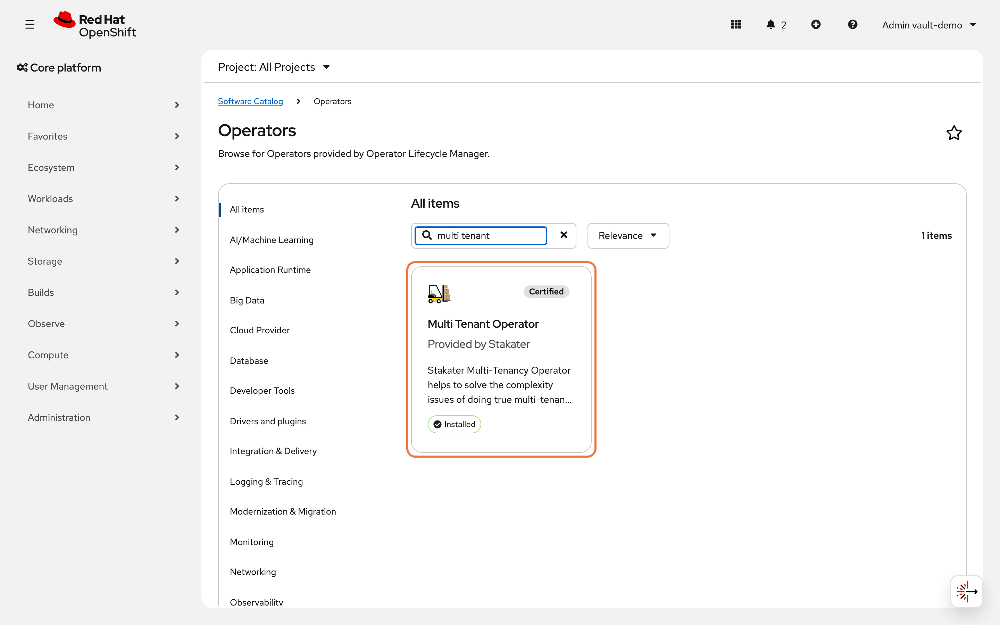
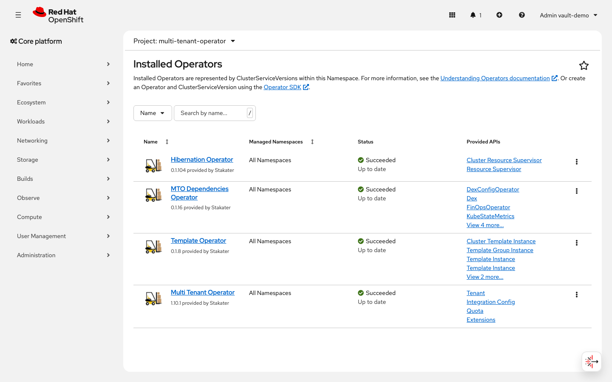
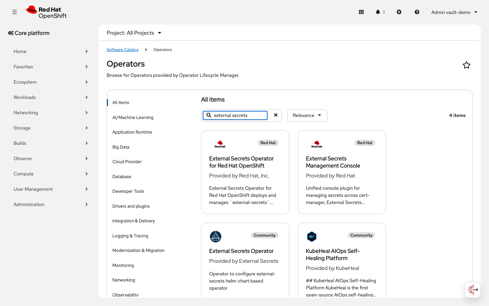
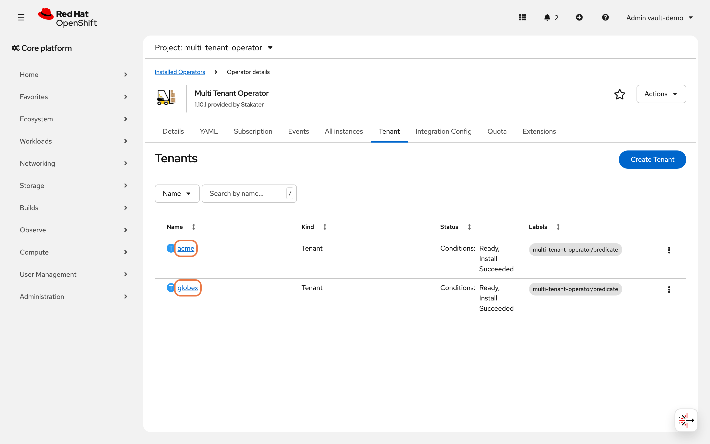
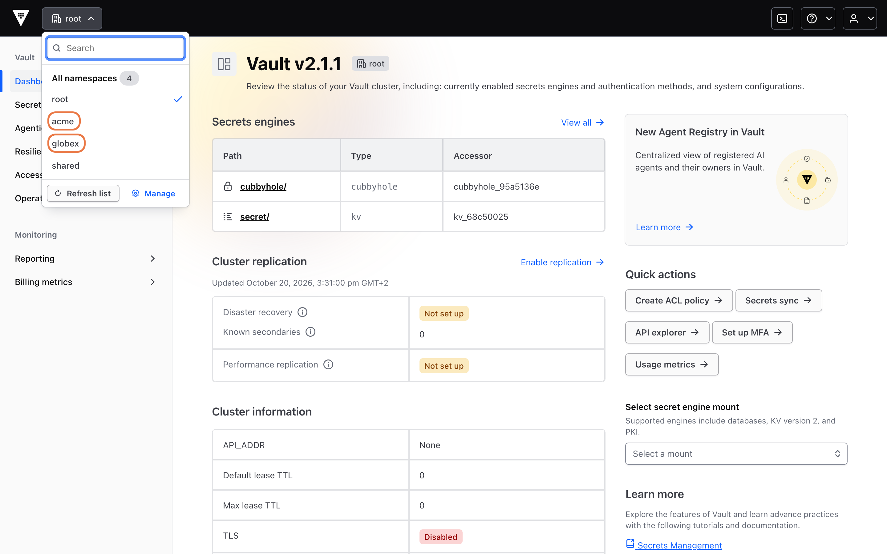
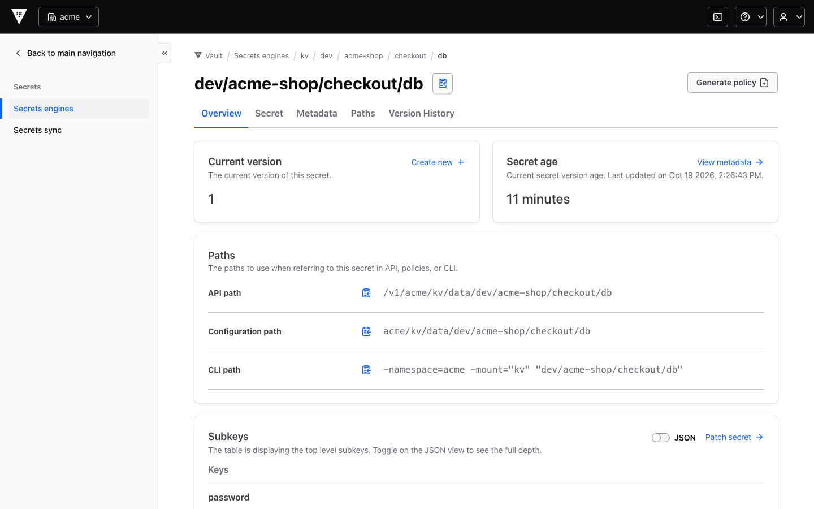

# Hands-on: tenants on OpenShift, carried into Vault Enterprise

<!--
Outlet: Red Hat Developer (tutorial), then the Stakater blog, canonical link back.
Companion to post 1, "One tenant, from OpenShift to Vault Enterprise", which explains why.
Screenshots: each "Screenshot to capture" line is a slot, filled during the validation run;
the file names are listed in screenshots/README.md.
-->

In [One tenant, from OpenShift to Vault Enterprise](../01-tenants-and-vault-enterprise/post.md),
we showed how a team defined once on OpenShift, as a tenant, can carry its
boundary into Vault Enterprise. This tutorial builds it, step by step.

By the end you'll have:

- two tenants, `acme` and `globex`, each with its own Vault namespace
- an app that reads its database password from Vault, without a Vault token
  or a hand-written policy
- a rotation in Vault that reaches the running pod
- proof that one tenant can't read the other's secrets, and that a policy
  changed by hand in Vault gets put back

Allow about an hour.

## Before you start

You need:

- An OpenShift 4 cluster, and `cluster-admin` on it
- A **Vault Enterprise license** for Vault 2.1 or later. You bring your own.
- `oc` and `helm` on your machine. You don't need the `vault` CLI, because
  every Vault command runs inside the Vault pod.
- The example files:

  ```bash
  git clone https://github.com/stakater/mto-blogs.git
  cd mto-blogs/02-try-it-tenants-and-vault-enterprise/examples
  ```

Here's what you'll install:

| Component | Version | From | Job |
|---|---|---|---|
| Multi-Tenant Operator | 1.10.0 or later | Software Catalog (OperatorHub) | Owns the tenants, and runs Template Operator |
| Vault Enterprise | 2.1.1 | HashiCorp Helm chart, Red Hat certified image | Holds the secrets |
| Vault Config Operator | v1.0.3 or later | Red Hat Community of Practice Helm chart | Writes Vault configuration from Kubernetes resources |
| External Secrets Operator | current | Software Catalog (OperatorHub) | Copies secrets from Vault into Kubernetes Secrets |
| Reloader | current | Stakater Helm chart | Rolls pods when their Secret changes |
| Vault Enterprise extension | current | `oci://ghcr.io/stakater/charts` | Turns each tenant into Vault configuration |

The Multi-Tenant Operator Basic edition is free with no expiry, and manages
up to two tenants. That's exactly what this tutorial uses.

## Step 1: Install Multi-Tenant Operator

In the OpenShift console, go to **Ecosystem → Software Catalog** (on older
versions, **Operators → OperatorHub**) and search for **multi tenant**. The
tile is named **Multi Tenant Operator**, without the hyphen, so a search for
"multi-tenant" doesn't find it.



Click **Install** and keep the defaults. The operator installs into the
`multi-tenant-operator` namespace.



Multi-Tenant Operator brings three companions with it: Template Operator,
Hibernation Operator and MTO Dependencies Operator.

Multi-Tenant Operator ships with Template Operator, which the extension
uses to render configuration for every tenant. Switch it on:

```bash
oc -n multi-tenant-operator patch integrationconfig tenant-operator-config \
  --type merge -p '{"spec":{"components":{"templateOperatorV2":{"mode":"Managed"}}}}'
```

When it's running, note the namespace and ServiceAccount it runs as. The
extension needs both in step 6:

```bash
oc get deploy -A -o custom-columns=NAMESPACE:.metadata.namespace,NAME:.metadata.name,SA:.spec.template.spec.serviceAccountName \
  | grep template-operator-v2

export TOP_NS=<namespace from the output>
export TOP_SA=<ServiceAccount from the output>
```

Multi-Tenant Operator now guards every namespace on the cluster. A new
namespace needs a tenant label, unless Multi-Tenant Operator lists it as
privileged. Even a cluster admin gets this refusal:

```
admission webhook "vnamespace.kb.io" denied the request: '<you>' cannot 'create'
namespace 'vault-config-operator' without label 'stakater.com/tenant'
```

The tools you install next are for the platform, not for a team. Add their
namespaces to the privileged list:

```bash
oc -n multi-tenant-operator patch integrationconfig tenant-operator-config --type json -p '[
  {"op":"add","path":"/spec/accessControl/privileged/namespaces/-","value":"^vault$"},
  {"op":"add","path":"/spec/accessControl/privileged/namespaces/-","value":"^vault-config$"},
  {"op":"add","path":"/spec/accessControl/privileged/namespaces/-","value":"^vault-config-operator$"},
  {"op":"add","path":"/spec/accessControl/privileged/namespaces/-","value":"^external-secrets$"},
  {"op":"add","path":"/spec/accessControl/privileged/namespaces/-","value":"^external-secrets-operator$"},
  {"op":"add","path":"/spec/accessControl/privileged/namespaces/-","value":"^reloader$"}
]'
```

The patch appends to the defaults (`default`, `openshift*`, `kube*`) and
keeps them. It covers the operators too: External Secrets Operator creates
and labels its own `external-secrets` namespace, and it's refused without
this list.

**In production,** give the platform tools a tenant of their own, such as
`platform`, so Multi-Tenant Operator manages their access like any team's.
This tutorial uses privileged namespaces to stay within the free edition's
two tenants.

## Step 2: Install Vault Enterprise

If you already run Vault Enterprise 2.1 or later and the cluster can reach
it, skip this step, and use your Vault's address wherever this tutorial says
`http://vault.vault.svc:8200`.

Otherwise, run a single Vault pod in **dev mode**. It keeps everything in
memory and a restart wipes it, so use it for learning only, never in
production.

```bash
oc new-project vault
oc -n vault create secret generic vault-ent-license --from-file=license=/path/to/vault.hclic

helm repo add hashicorp https://helm.releases.hashicorp.com
helm upgrade --install vault hashicorp/vault --version 0.34.1 -n vault \
  --set global.openshift=true \
  --set server.dev.enabled=true \
  --set server.dev.devRootToken=root \
  --set server.authDelegator.enabled=true \
  --set server.image.repository=registry.connect.redhat.com/hashicorp/vault-enterprise \
  --set server.image.tag=2.1.1-ent-ubi \
  --set server.enterpriseLicense.secretName=vault-ent-license \
  --set injector.enabled=false \
  --set ui.enabled=true

oc -n vault wait --for=condition=Ready pod/vault-0 --timeout=300s
oc -n vault create route edge vault-ui --service=vault
```

The image is the Red Hat certified build of Vault Enterprise, from
`registry.connect.redhat.com`, which your cluster's pull secret already
covers. Write the registry out in full: OpenShift maps the short name
`hashicorp/vault-enterprise` to that registry, where the tags end in `-ubi`.

Define two shell helpers that run the `vault` CLI inside the pod. `v` uses
the root token. `vt` uses a token you pass in, so you can act as an app:

```bash
v()  { oc -n vault exec -i vault-0 -- env VAULT_ADDR=http://127.0.0.1:8200 VAULT_TOKEN=root vault "$@"; }
vt() { local t=$1; shift; oc -n vault exec -i vault-0 -- env VAULT_ADDR=http://127.0.0.1:8200 VAULT_TOKEN="$t" vault "$@"; }

v version
```

```
Vault v2.1.1+ent (...)
```

## Step 3: Install Vault Config Operator

Vault Config Operator turns Vault configuration into Kubernetes resources,
such as a `Policy` or a Vault `Namespace`, and writes them to Vault.

```bash
helm repo add vault-config-operator https://redhat-cop.github.io/vault-config-operator
helm upgrade --install vault-config-operator vault-config-operator/vault-config-operator \
  --version v1.0.3 -n vault-config-operator --create-namespace \
  --set 'env[0].name=VAULT_ADDR'             --set 'env[0].value=http://vault.vault.svc:8200' \
  --set 'env[1].name=ENABLE_DRIFT_DETECTION' --set-string 'env[1].value=true' \
  --set 'env[2].name=SYNC_PERIOD_SECONDS'    --set-string 'env[2].value=60' \
  --set 'env[3].name=CACHE_VAULT_TOKEN'      --set-string 'env[3].value=true'

oc -n vault-config-operator rollout status deploy/vault-config-operator --timeout=300s
```

Two settings matter here:

- **Drift detection every 60 seconds.** Vault Config Operator compares Vault
  with its resources and puts back anything changed by hand. You'll see this
  in step 10.
- **`CACHE_VAULT_TOKEN`.** Vault Config Operator reuses one Vault token,
  instead of logging in again on every check.

## Step 4: Install External Secrets Operator and Reloader

In **Ecosystem → Software Catalog**, install **External Secrets Operator for
Red Hat OpenShift** with the defaults.



Then tell it to deploy External Secrets Operator. The operator isolates its
pods with deny-all network policies, so also let the controller reach Vault:

```bash
cat <<'YAML' | oc apply -f -
apiVersion: operator.openshift.io/v1alpha1
kind: ExternalSecretsConfig
metadata:
  name: cluster
spec:
  controllerConfig:
    networkPolicies:
      - name: allow-egress-to-vault
        componentName: ExternalSecretsCoreController
        egress:
          - to:
              - namespaceSelector:
                  matchLabels:
                    kubernetes.io/metadata.name: vault
            ports:
              - protocol: TCP
                port: 8200
YAML

oc wait externalsecretsconfig/cluster --for=condition=Ready --timeout=300s
oc -n external-secrets rollout status deploy/external-secrets-webhook --timeout=300s
```

Wait for the webhook, not only for the `ExternalSecret` CRD. The operator
installs the CRD before External Secrets Operator itself runs, and it
reports `Ready` before the pods start.

Install Reloader:

```bash
helm repo add stakater https://stakater.github.io/stakater-charts
helm upgrade --install reloader stakater/reloader -n reloader --create-namespace \
  --set reloader.isOpenshift=true \
  --set reloader.deployment.securityContext.runAsUser=null

oc -n reloader rollout status deploy/reloader-reloader --timeout=300s
```

The chart pins the user ID `65534` by default, which OpenShift's
`restricted-v2` security context constraint refuses. Setting it to `null`
lets OpenShift assign one from the project's range.

## Step 5: Give Vault Config Operator its login to Vault

Vault Config Operator logs in to Vault **once**, in the root namespace, with
Vault's Kubernetes auth method. From there it writes into each tenant's
Vault namespace. A Vault admin sets this up one time:

```bash
v auth enable kubernetes
v write auth/kubernetes/config kubernetes_host=https://kubernetes.default.svc:443
v policy write vco-admin - < vco-admin-policy.hcl
v write auth/kubernetes/role/vco-admin \
  bound_service_account_names=vco-admin \
  bound_service_account_namespaces=vault-config \
  token_policies=vco-admin token_ttl=1h
```

Vault warns that the role `vco-admin` has no audience configured. That's
expected here, and you can ignore it.

**What just happened:** the policy in
[`vco-admin-policy.hcl`](examples/vco-admin-policy.hcl) grants only the
paths the extension needs. It also **denies deletes** on the tenants' Vault
namespaces and KV engines, so removing a tenant never deletes its secrets.
Vault checks the cluster's tokens with its own ServiceAccount, which the
Helm chart allowed to do so in step 2. No credential is stored anywhere.

**In production,** don't log Vault Config Operator in at the root namespace.
Create a dedicated parent Vault namespace, such as `tenants`, run these
commands inside it (add `-namespace=tenants`), and install the extension in
step 6 with `--set vco.namespace=tenants`. Each tenant then becomes a Vault
namespace below it, such as `tenants/acme`, and nothing outside `tenants` is
in Vault Config Operator's reach. This tutorial uses the root namespace only
to keep the commands short.

## Step 6: Install the extension

```bash
helm upgrade --install mto-extension-vault-enterprise-bootstrap \
  oci://ghcr.io/stakater/charts/mto-extension-vault-enterprise-bootstrap \
  -n vault-config --create-namespace \
  --set parent.vaultServer=http://vault.vault.svc:8200 \
  --set templateOperator.namespace="$TOP_NS" \
  --set templateOperator.serviceAccountName="$TOP_SA"
```

**What just happened:** the chart created the `vco-admin` ServiceAccount
that step 5 trusted in Vault. It now watches every `Tenant` on the cluster.
There are no tenants yet, so Vault has nothing new.

## Step 7: Create two tenants

[`tenants.yaml`](examples/tenants.yaml) defines two teams. Each has an owner,
one project and a quota. Every tenant must name a `Quota`, so the file also
holds a small one, `small`, which only caps the number of pods:

```yaml
apiVersion: tenantoperator.stakater.com/v1beta3
kind: Tenant
metadata:
  name: acme
spec:
  quota: small
  accessControl:
    owners:
      users:
        - anna@example.com
  namespaces:
    withTenantPrefix:
      - shop
```

```bash
oc apply -f tenants.yaml
```

Multi-Tenant Operator creates the projects `acme-shop` and `globex-web`, and
labels each with its tenant.

> 📷 **Screenshot to capture:** the OpenShift console, project `acme-shop`,
> **Details** tab, with the label `stakater.com/tenant=acme`.

In the console, open **Ecosystem → Installed Operators → Multi Tenant
Operator** and the **Tenant** tab:



Multi-Tenant Operator's own console shows the same tenants from a team's
point of view: each tenant with its projects and its quota.

> 📷 **Screenshot to capture:** the Multi-Tenant Operator console, tenant
> `acme`, showing its project `acme-shop` and its quota `small`.

Within a minute, each tenant has its own Vault namespace:

```bash
v namespace list
```

```
Keys
----
acme/
globex/
shared/
```

`shared/` is where tenants exchange values when both of them choose to.
Look inside one tenant's Vault namespace:

```bash
v secrets list -namespace=acme    # kv/ : the tenant's own secrets engine
v auth list -namespace=acme       # kubernetes/workloads/ : how its apps log in
```

Open the Vault UI at the route from step 2 and sign in with the token
`root`. The tenants appear as Vault namespaces.

```bash
echo "https://$(oc -n vault get route vault-ui -o jsonpath='{.spec.host}')"
```



**What just happened:** you created two Kubernetes resources and didn't
touch Vault. Multi-Tenant Operator labeled the projects. Template Operator
rendered Vault configuration for each tenant, and Vault Config Operator
wrote it into Vault.

That configuration is ordinary Kubernetes resources, in the `vault-config`
namespace, so you can see it, review it and keep it in Git:

```bash
oc -n vault-config get namespaces.redhatcop.redhat.io,secretenginemounts.redhatcop.redhat.io
```

> 📷 **Screenshot to capture:** the OpenShift console, **Home → API
> Explorer** (or **Search**), the Vault Config Operator `Namespace` resources
> in `vault-config`: `acme`, `globex` and `shared`.

## Step 8: Deploy an app that reads its secret

Put a database password at the app's own path, in tenant `acme`'s Vault
namespace:

```bash
v kv put -namespace=acme -mount=kv dev/acme-shop/checkout/db password=s3cr3t
```

The app, in [`checkout.yaml`](examples/checkout.yaml), asks for access with
annotations. Its ServiceAccount asks for its own space, with the `editor` role:

```yaml
metadata:
  name: checkout
  namespace: acme-shop
  annotations:
    vault.stakater.com/kv: "true"
    vault.stakater.com/role: editor
```

Its Deployment asks for one key, and for a restart when that key changes:

```yaml
metadata:
  annotations:
    vault.stakater.com/kv-secret.db: db#password
    reloader.stakater.com/auto: "true"
```

Deploy it:

```bash
oc apply -f checkout.yaml
oc -n acme-shop get externalsecret,secret checkout-db
oc -n acme-shop logs deploy/checkout
```

```
db password has 6 characters
```

The app prints the length of the password, not the password.



In the same Vault namespace, open **Policies**. The app's policy is there,
and nobody wrote it:

> 📷 **Screenshot to capture:** the Vault UI in namespace `acme`,
> **Policies**, showing `kv.acme.acme-shop.checkout`, opened to its rules:
> access to `dev/acme-shop/checkout/` only.

On the cluster, the password arrived as an ordinary Secret, owned by the
`ExternalSecret` that keeps it in step with Vault:

> 📷 **Screenshot to capture:** the OpenShift console, project `acme-shop`,
> **Workloads → Secrets → checkout-db**, showing the key `password` (value
> hidden) and the owner `ExternalSecret checkout-db`.

**What just happened:** the extension gave `checkout` a Vault policy and a
login role in tenant `acme`'s Vault namespace, limited to its own path.
External Secrets Operator logged in as `checkout`, read the password and
wrote the Kubernetes Secret `checkout-db`. The app reads it like any other
Secret. Nobody wrote a policy or handled a Vault token. The Vault settings
the app was given are in a ConfigMap, if you want to see them:

```bash
oc -n acme-shop get configmap vault-config-checkout -o yaml
```

## Step 9: Rotate the secret

Change the password in Vault:

```bash
v kv put -namespace=acme -mount=kv dev/acme-shop/checkout/db password=n3w-s3cr3t
```

External Secrets Operator picks up changes on its next refresh, which is
every hour by default. To skip the wait, force a refresh:

```bash
oc -n acme-shop annotate externalsecret checkout-db force-sync="$(date +%s)" --overwrite
sleep 15   # the Secret updates, then Reloader starts the rollout
oc -n acme-shop rollout status deploy/checkout
oc -n acme-shop logs deploy/checkout
```

```
db password has 10 characters
```

**What just happened:** the Secret changed, so Reloader rolled the pod, and
the new pod started with the new password.

In the Vault UI, the secret now has two versions:

> 📷 **Screenshot to capture:** the Vault UI in namespace `acme`, the secret
> `dev/acme-shop/checkout/db`, **Version History**, showing versions 1 and 2.

## Step 10: Check the isolation

Now prove the boundary holds. Give tenant `globex` an app, and log in to
Vault as that app, with its own ServiceAccount token:

```bash
oc apply -f web.yaml
JWT=$(oc -n globex-web create token web)
ROLE=$(oc -n globex-web get configmap vault-config-web -o jsonpath='{.data.VAULT_K8S_ROLE}')
GLOBEX=$(v write -namespace=globex -field=token auth/kubernetes/workloads/login \
  role="$ROLE" jwt="$JWT")
```

**Allowed:** globex's app writes and reads in its own space:

```bash
vt "$GLOBEX" kv put -namespace=globex -mount=kv dev/globex-web/web/api key=abc
vt "$GLOBEX" kv get -namespace=globex -mount=kv dev/globex-web/web/api
```

**Refused:** the same token can't read tenant `acme`'s password:

```bash
vt "$GLOBEX" kv get -namespace=acme -mount=kv dev/acme-shop/checkout/db
```

```
Code: 403. Errors:

* preflight capability check returned 403, please ensure client's policies grant access to path "kv/"
```

**Refused:** globex's app can't log in with acme's role either:

```bash
ACME_ROLE=$(oc -n acme-shop get configmap vault-config-checkout -o jsonpath='{.data.VAULT_K8S_ROLE}')
v write -namespace=acme auth/kubernetes/workloads/login role="$ACME_ROLE" jwt="$JWT"
```

```
Code: 403. Errors:

* service account name not authorized
```

Vault refuses the login, because acme's role trusts only the `checkout`
ServiceAccount in `acme-shop`.

**Put back:** widen acme's app policy by hand, as someone might during an
incident, then wait:

```bash
v policy read -namespace=acme kv.acme.acme-shop.checkout
echo 'path "*" { capabilities = ["read","list"] }' | v policy write -namespace=acme kv.acme.acme-shop.checkout -
sleep 90
v policy read -namespace=acme kv.acme.acme-shop.checkout
```

The policy is back to what it was. Vault Config Operator noticed the
difference and rewrote it.

## Optional: single sign-on for people

So far, only apps log in. The extension can also give each tenant an OIDC
login for people, with four roles: `viewer`, `editor`, `admin` and
`audit-read`. Each role maps to an identity-provider group named
`<tenant>-<role>s`, such as `acme-editors`.

You need an OIDC identity provider, such as Red Hat build of Keycloak, with
a client for Vault:

```bash
oc -n vault-config create secret generic vault-oidc-client-secret \
  --from-literal=client-secret='<the client secret>'

helm upgrade mto-extension-vault-enterprise-bootstrap \
  oci://ghcr.io/stakater/charts/mto-extension-vault-enterprise-bootstrap \
  -n vault-config --reuse-values \
  --set parent.sso.enabled=true \
  --set parent.sso.issuerUrl=https://<your identity provider's issuer URL> \
  --set tenantValues.sso.oidc.clientId=<the client ID, default vault>
```

A member of `acme-editors` now signs in to tenant `acme`:

```bash
VAULT_NAMESPACE=acme vault login -method=oidc -path=oidc/sso role=sso.acme.editor
```

By default the login accepts only the Vault CLI's local callback. For
sign-in through the Vault UI, also set `parent.sso.allowedRedirectUris` to
your Vault UI's callback URL.

## Clean up

Remove things in this order. Vault Config Operator still needs its login
and permissions to finish removing what it wrote.

```bash
oc delete -f checkout.yaml -f web.yaml
oc delete -f tenants.yaml
oc -n vault-config delete templateinstances.templates.v2.stakater.com mto-extension-vault-enterprise-parent --wait
oc -n vault-config get namespaces.redhatcop.redhat.io,policies.redhatcop.redhat.io   # wait until none are left
helm uninstall mto-extension-vault-enterprise-bootstrap -n vault-config
```

Use the full name `templateinstances.templates.v2.stakater.com`. On
OpenShift, the short name `templateinstance` means OpenShift's own template
resource.

The tenants' Vault namespace resources stay `Terminating`. That's on
purpose: the policy denies deleting a tenant's data, so that stays a
person's decision. In this learning setup, uninstall Vault, which wipes its
in-memory data, then release them:

```bash
helm uninstall vault -n vault
for r in $(oc -n vault-config get namespaces.redhatcop.redhat.io,secretenginemounts.redhatcop.redhat.io -o name); do
  oc -n vault-config patch "$r" --type merge -p '{"metadata":{"finalizers":null}}'
done
```

## What you built

Two teams, defined once on OpenShift. Each got its own Vault namespace, its
own secrets engine and its own login, without anyone writing Vault
configuration by hand. Apps asked for secrets with annotations. Rotations
reached the running pod, and the boundary between the tenants held.

One thing was left out on purpose: people. Apart from the optional section,
everything here signed in as an app or as Vault's root token. Signing team
members in once, to both the OpenShift console and Vault, with each person
seeing only their own tenant, needs an identity provider with groups and a
change to the OpenShift login. That's a tutorial of its own, and it's the
next pair of posts in this series.

The free edition stops at two tenants. When a third team arrives, that's
where Multi-Tenant Operator Enterprise comes in.

## About Multi-Tenant Operator

Multi-Tenant Operator, from Stakater, turns a shared OpenShift cluster into
a platform of tenants. Each team is defined once, and that boundary reaches
its projects, its access, its quotas, its costs and, through extensions,
tools such as Vault. It's a Red Hat certified operator, available in
OperatorHub.

- **Try it free:** the Basic edition manages up to two tenants, with no
  expiry and no capability held back.
- **Learn more:** [docs.stakater.com/mto](https://docs.stakater.com/mto/)
- **Running more than two teams?** Multi-Tenant Operator Enterprise adds
  unlimited tenants and a support commitment. Contact
  [sales@stakater.com](mailto:sales@stakater.com).

---

*Ayesha Arshad, Stakater. Rasheed Amir, Stakater. Raffaele Spazzoli, Red Hat.*
