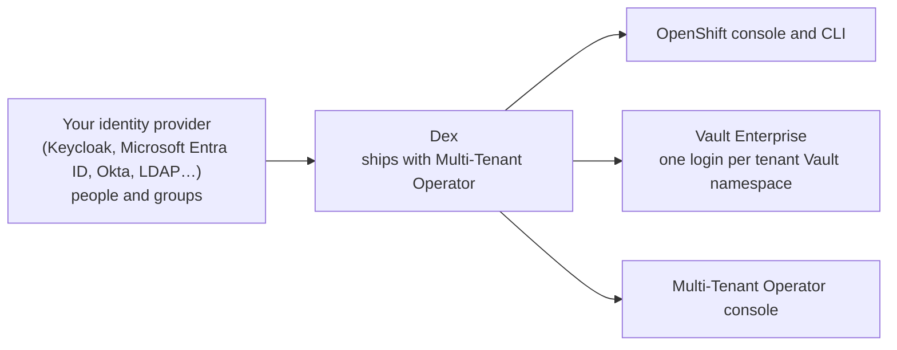
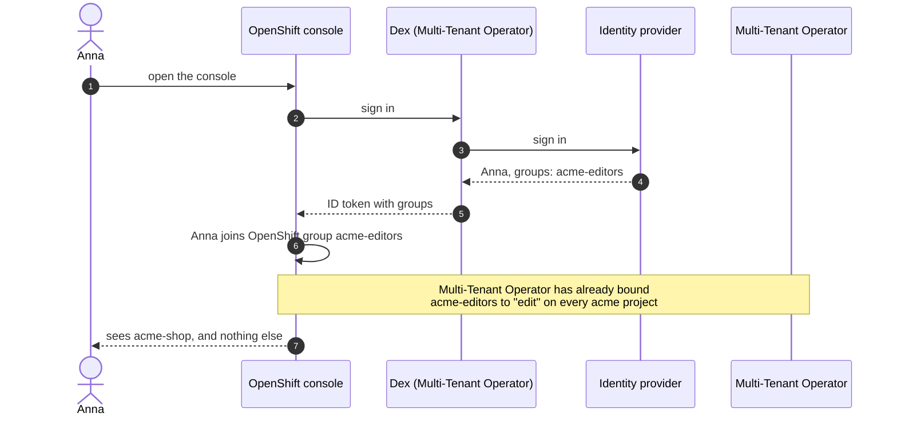
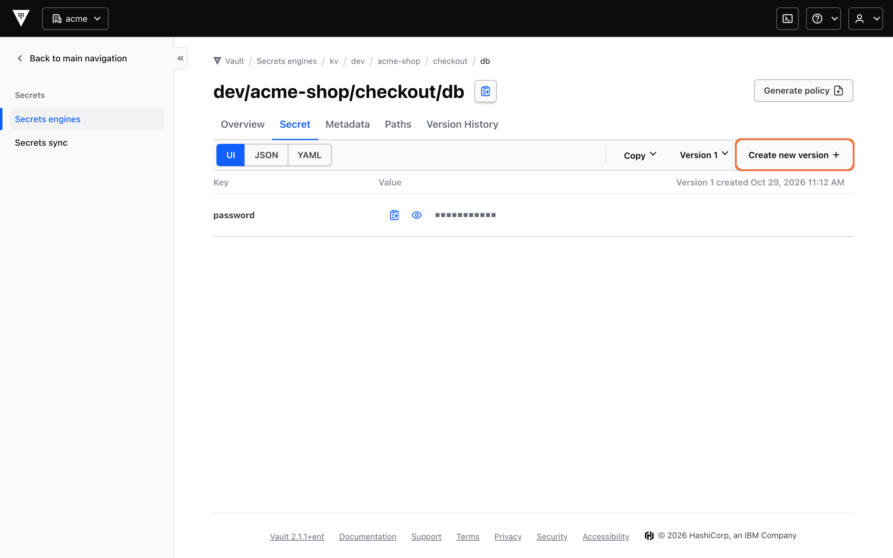

# One login, every tool: tenant members on OpenShift and Vault

<!--
Outlet: Red Hat Developer (explainer), then the Stakater blog, canonical link back.
Follows posts 1 and 2 (tenants and Vault, for apps). Its tutorial is post 4.
Authors: Ayesha Arshad (Stakater), Rasheed Amir (Stakater), Raffaele Spazzoli (Red Hat).
Target: about 1,800 words.
Title options:
  - One login, every tool: tenant members on OpenShift and Vault
  - Join a team once: one sign-in for OpenShift and Vault, per tenant
  - Who can see what: tenant access for people, from OpenShift to Vault
-->

Anna joins the `acme` team on Monday. By lunchtime she needs to see her
team's projects in the OpenShift console, and to update a database password
in Vault. She should see nothing that belongs to any other team. When she
moves teams in six months, her access should move with her. When she leaves,
it should disappear everywhere at once.

On most shared OpenShift platforms, that's three tickets, two separate
logins, and a cleanup that nobody quite finishes.

In [One tenant, from OpenShift to Vault Enterprise](../01-tenants-and-vault-enterprise/post.md),
we used Multi-Tenant Operator to carry a team's boundary, the **tenant**,
from OpenShift into Vault, so each team's apps get their own secrets and
nothing else. This article does the same for **people**. Anna signs in once,
with her company account, and the tenant decides what she sees in every
tool: OpenShift, Vault, and the Multi-Tenant Operator console.

**In this article:**

- what giving one person access to one team costs today, across OpenShift
  and Vault
- the idea: identity stays in your identity provider, and the tenant decides
  what a group means everywhere
- how Multi-Tenant Operator connects your identity provider to every tool,
  through the Dex it already runs
- what happens when people join, move and leave
- the guardrails to agree with your identity and security teams

**Who it's for:** platform engineers and architects running OpenShift with
Vault Enterprise, and the people who run identity in those organizations.
It builds on the first article, so read that first if tenants are new to
you.

**Want to build it?** The companion tutorial,
[Hands-on: one login for tenant members](https://github.com/stakater/mto-blogs/tree/main/04-try-it-one-login-for-tenant-members),
sets it up on the cluster from the first tutorial, step by step.

### Why this is a separate article

The first pair of articles is about apps: how a workload gets its secrets,
and how tenants stay apart. Signing people in is a different problem. It
brings in an identity provider, group membership, and a change to how
OpenShift itself signs people in. Putting both in one article would have
doubled its length and mixed two questions. Here, the apps already work.
This is about the people.

## What one person costs today

Take Anna, joining `acme` as an editor. Done properly, by hand:

**In OpenShift**

- Create or update an OpenShift group for the team's editors, and add Anna.
- Bind that group to the `edit` role in every one of the team's projects,
  and remember to do it again when the team adds a project.

**In Vault**

- Set up an OIDC login method in the team's Vault namespace, if it isn't
  there yet.
- Write a policy for each access level: viewer, editor, admin, auditor.
- Write a login role for each level, bound to the right group.

**Then do it again for every team, and keep it right.** A new team means
the whole set again, in both tools. A mover needs one group swapped for
another, in both tools. A leaver needs removing from both, and from every
other tool the team uses.

The pattern is the same as for apps in the first article, with one
difference: these are people, and mistakes here are the ones auditors ask
about. Platform teams end up in familiar places:

- **Broad access for everyone.** Quick, and every developer can see every
  team's secrets.
- **A ticket per person, per tool.** Safe, and onboarding takes days.
- **Kept by hand, in each tool.** Someone leaves, is removed from one tool,
  and keeps their access in another.

## The idea: one group, one meaning, everywhere

The fix is to keep each decision in exactly one place.

- **Who is in which team** stays in your identity provider, as groups. It's
  already where HR processes, joiners and leavers are handled. Nothing
  about people is copied into OpenShift or Vault.
- **What each group may do** is decided by the tenant. A group name follows
  one pattern, `<tenant>-<level>s`, so `acme-editors` means "editors of
  tenant `acme`", in every tool.

Then each tool follows the tenant:

| The group | In OpenShift | In Vault |
|---|---|---|
| `acme-admins` | `admin` on every `acme` project | `admin` in the `acme` Vault namespace |
| `acme-editors` | `edit` on every `acme` project | `editor`: read and write the team's secrets |
| `acme-viewers` | `view` on every `acme` project | `viewer`: read, never write |
| `acme-audit-reads` | nothing | `audit-read`: see which secrets exist, never their values |

On the OpenShift side, the tenant names its groups:

```yaml
apiVersion: tenantoperator.stakater.com/v1beta3
kind: Tenant
metadata:
  name: acme
spec:
  accessControl:
    owners:
      groups: [acme-admins]
    editors:
      groups: [acme-editors]
    viewers:
      groups: [acme-viewers]
  namespaces:
    withTenantPrefix:
      - shop
```

Multi-Tenant Operator binds those groups in every project the tenant owns,
including projects added later. On the Vault side, the extension from the
first article creates one login role per access level in each tenant's
Vault namespace, each bound to its group. No per-person configuration exists
anywhere.

Joining, moving and leaving become one action, in one place:

- **Joins:** add Anna to `acme-editors` in the identity provider.
- **Moves:** swap `acme-editors` for `globex-editors`.
- **Leaves:** remove her from the group, or disable her account.

Nobody touches OpenShift or Vault for any of it.

## How it connects: the Dex that ships with Multi-Tenant Operator

Each tool needs to trust your identity provider and receive Anna's groups.
You could connect every tool to the identity provider directly. Then every
new tool means another client, another set of claims to map, and another
place to update when the identity provider changes.

Multi-Tenant Operator already runs **Dex**, an open source OpenID Connect
provider, for its own console, and manages it through Kubernetes resources.
So Dex becomes the one connection to your identity provider, and every tool
becomes a client of Dex:



- **One connection to your identity provider,** described as a `Connector`
  resource. Changing identity providers later changes that one resource.
- **Each tool is a `Client` resource.** Adding a tool is a few lines of
  YAML, not a project.
- **The groups claim is the same everywhere,** so `acme-editors` arrives
  with the same name in every tool.

When Anna opens the OpenShift console, this is what happens:



Vault works the same way. Anna signs in to the `acme` Vault namespace with
the role for her level. Vault checks her groups claim, and issues a token
with editor rights in `acme` only.

## What Anna sees

In the OpenShift console, Anna sees her team's projects, and no others.

> 📷 **Screenshot to capture** (`04-openshift-anna-projects.png`): the OpenShift
> console signed in as Anna, the Projects page, with only `acme-shop` in the list.
> **Highlight:** the row `acme-shop`.

In Vault, she sees her team's secrets, with the editor's "Create new
version" button:



If she tries the `globex` Vault namespace, Vault refuses her sign-in,
because none of her groups belong to that tenant.

## Guardrails to agree with your identity and security teams

- **Group membership is the grant.** Whoever can add people to `acme-editors`
  controls access to tenant `acme`, in every tool. Keep those groups with
  the people who own the team, and review them like any other access.
- **No group, no access.** Vault's login roles accept only the tenant's own
  groups, and there's no fallback role by default. Someone with a valid
  company account but none of the tenant's groups gets nothing. The
  extension's end-to-end tests check that each group gives exactly its
  level, in its own tenant only.
- **Sessions end on their own clock.** Removing Anna from a group stops her
  next sign-in. Sessions she already has last until they expire: a Vault
  sign-in lasts 15 minutes by default, renewable up to an hour, and an
  OpenShift session lasts as long as your cluster is configured for. For an immediate cut-off, revoke her sessions
  as part of your leaver process.
- **Vault stays in charge.** People sign in through Vault's own OIDC method,
  and OpenShift through its own identity provider configuration. Nothing
  goes around either.

## Try it

The tutorial,
[Hands-on: one login for tenant members](https://github.com/stakater/mto-blogs/tree/main/04-try-it-one-login-for-tenant-members),
continues on the cluster from the first tutorial. It runs a Keycloak as a
stand-in for your company's identity provider, connects it to the Dex that
ships with Multi-Tenant Operator, and signs Anna in to OpenShift and Vault.
Then it moves her out of the team and shows her access go. It still fits
the free Basic edition's two tenants.

## What's next

OpenShift and Vault are two tools. A team uses many more: Argo CD to
deploy, Grafana to watch, a registry for its images. Each of them can follow
the same tenant and the same groups, through the same Dex. That's where this
series goes next.

## About Multi-Tenant Operator

Multi-Tenant Operator, from Stakater, turns a shared OpenShift cluster into
a platform of tenants. Each team is defined once, and that boundary reaches
its projects, its access, its quotas, its costs and, through extensions,
tools such as Vault. It's a Red Hat certified operator, available in
OperatorHub.

- **Try it free:** the Basic edition manages up to two tenants, with no
  expiry and no capability held back.
- **Learn more:** [docs.stakater.com/mto](https://docs.stakater.com/mto/)
- **Running more than two teams?** Multi-Tenant Operator Enterprise adds
  unlimited tenants and a support commitment. Contact
  [sales@stakater.com](mailto:sales@stakater.com).

---

*Ayesha Arshad, Stakater. Rasheed Amir, Stakater. Raffaele Spazzoli, Red Hat.*
