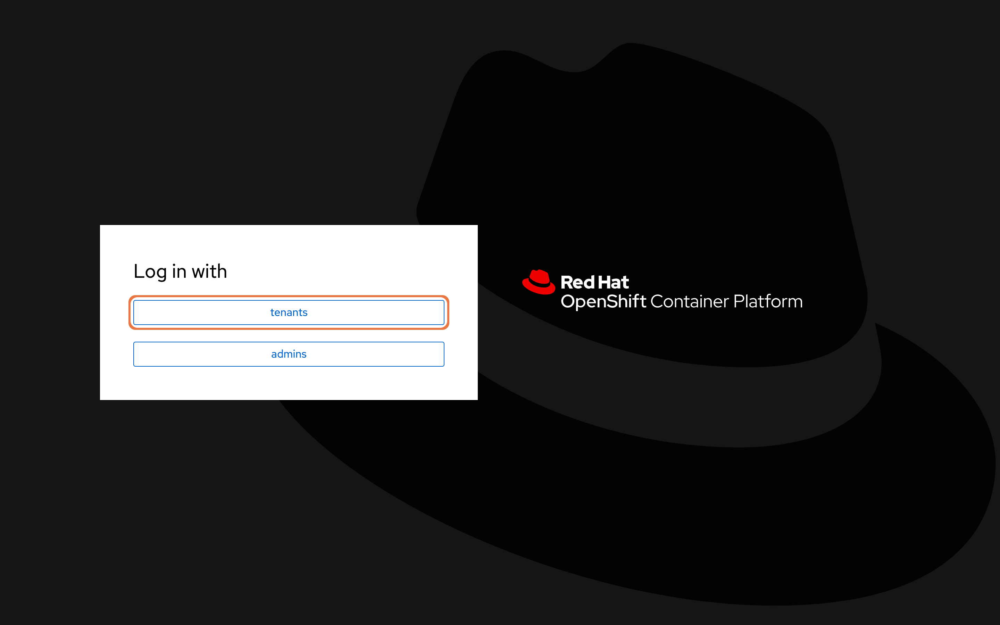
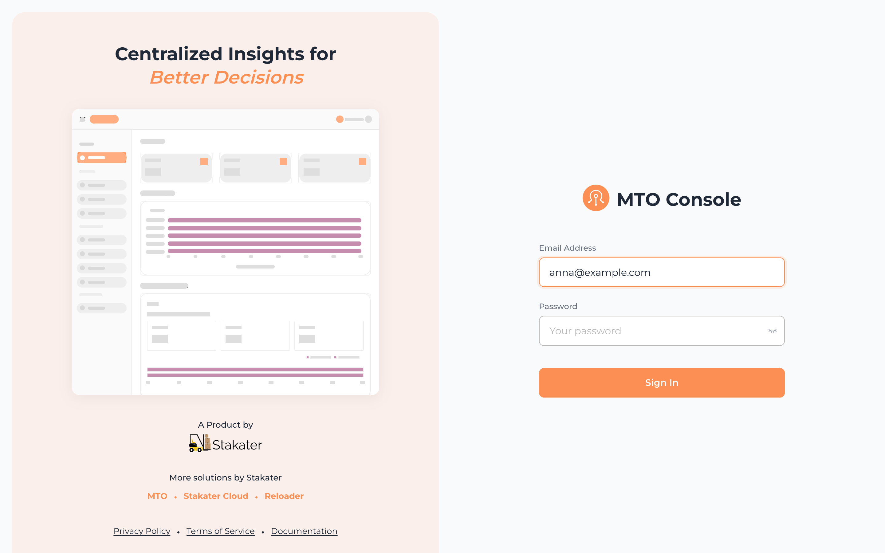
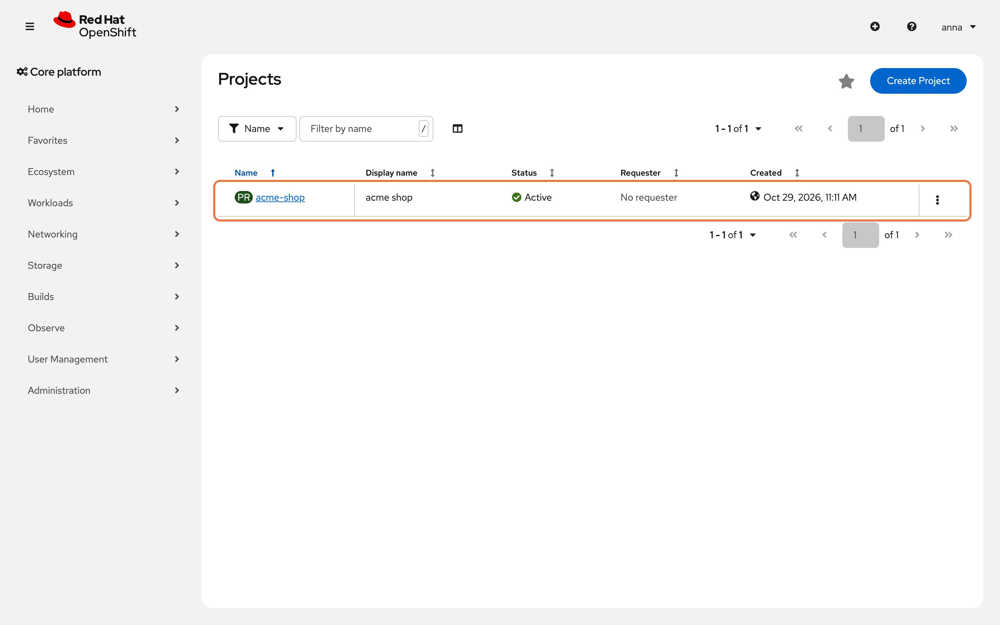
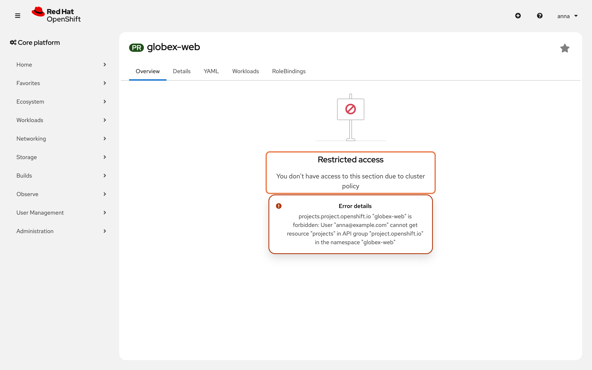
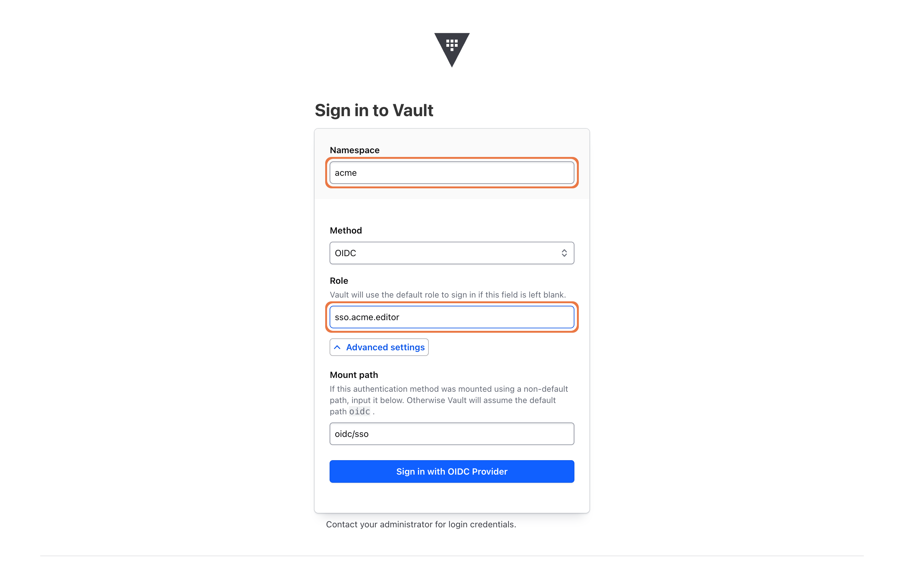
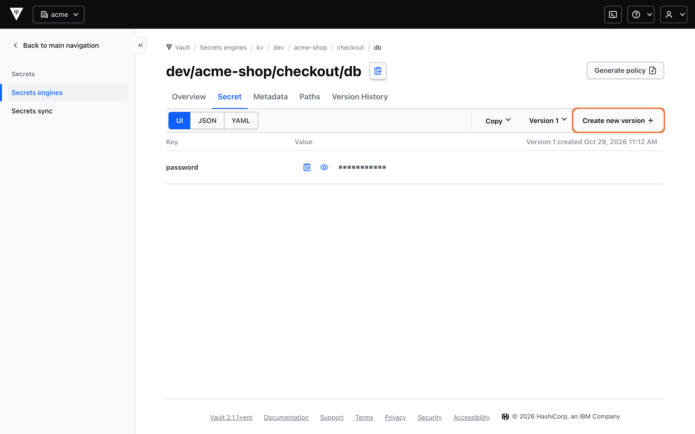
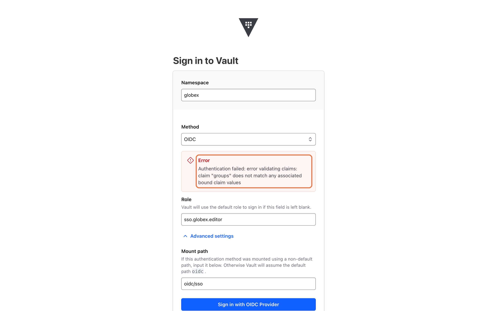
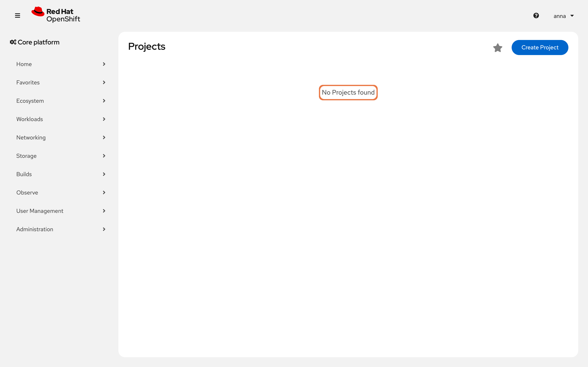

# Hands-on: one login for tenant members, on OpenShift and Vault

<!--
Outlet: Red Hat Developer (tutorial), then the Stakater blog, canonical link back.
Companion to post 3, "One login, every tool", which explains why.
Continues on the cluster from post 2.
Screenshots: each "Screenshot to capture" line is a slot, filled during the validation run.
Its "Highlight" line says what the capture marks. The full list, with highlights, is in
screenshots/README.md.
-->

In [One login, every tool](../03-one-login-for-tenant-members/post.md), we
showed how one group in your identity provider, such as `acme-editors`, can
decide what a person sees in OpenShift and in Vault, through the tenant.
This tutorial builds it.

By the end:

- Anna signs in to the OpenShift console with one account, and sees only
  her team's project
- she signs in to Vault with the same account, and edits only her team's
  secrets
- she's refused in the other team, in both tools
- you remove her from the team in one place, and her access goes in both
  tools

Allow about an hour. Validated on OpenShift 4.21.

### Why this is a separate tutorial

The [first tutorial](../02-try-it-tenants-and-vault-enterprise/post.md)
gave apps their secrets. This one adds people, which brings in an identity
provider and a change to how OpenShift signs people in. Keeping them apart
keeps each one short enough to finish, and you can stop after the first if
apps are all you need.

## Before you start

You need the cluster from the first tutorial, with everything from it
running: Multi-Tenant Operator, Vault Enterprise with the `vault-ui` route,
Vault Config Operator, External Secrets Operator, the extension, and the two
tenants. Keep the `v` helper from it. `v` is short for `vault`: it runs the
`vault` command inside the Vault pod, with the root token. If you're in a
new shell, define it again:

```bash
v() { oc -n vault exec -i vault-0 -- env VAULT_ADDR=http://127.0.0.1:8200 VAULT_TOKEN=root vault "$@"; }
```

You also need `openssl` and `htpasswd` on your machine, and a private
browser window for signing in as Anna. `htpasswd` comes with macOS. On
Fedora and Red Hat Enterprise Linux, it's in the `httpd-tools` package.

The example files are in the same repository:

```bash
cd mto-blogs/04-try-it-one-login-for-tenant-members/examples
```

Here's what you'll set up:

| Component | Version | Where it comes from | Job |
|---|---|---|---|
| Dex | Ships with Multi-Tenant Operator | Already running, from the first tutorial | Holds the people and their groups, and signs them in; OpenShift and Vault are its clients |
| OpenShift OAuth | Built in | Your cluster | Signs people in to OpenShift through Dex, and takes their groups |
| The tenants | – | The first tutorial | Name the groups that may use them |
| The Vault Enterprise extension | 0.1.0 | Installed in the first tutorial | Gives each tenant a Vault sign-in, one role per access level |

## Step 1: Collect the addresses

Every piece needs to know where the others are:

```bash
DEX_ISSUER=$(oc -n multi-tenant-operator get dexconfig dex-operator-config -o jsonpath='{.spec.issuer}')
OAUTH_HOST=$(oc -n openshift-authentication get route oauth-openshift -o jsonpath='{.spec.host}')
VAULT_UI_HOST=$(oc -n vault get route vault-ui -o jsonpath='{.spec.host}')
echo "$DEX_ISSUER  $OAUTH_HOST  $VAULT_UI_HOST"
```

`DEX_ISSUER` is the address of the Dex that Multi-Tenant Operator runs for
its own console.

Check whether your cluster's router certificate is trusted by public
certificate authorities. On most managed clusters it is:

```bash
curl -s "$DEX_ISSUER/.well-known/openid-configuration" >/dev/null && echo trusted || echo "not trusted"
```

If it says **not trusted**, save the router's certificate authority. Later
steps use it, each marked "if not trusted":

```bash
oc -n openshift-config-managed get configmap default-ingress-cert \
  -o jsonpath='{.data.ca-bundle\.crt}' > ingress-ca.crt
```

## Step 2: Create the people and their groups

Multi-Tenant Operator runs Dex, and the Dex Config Operator that comes with
it turns Kubernetes resources into Dex's configuration. In this tutorial,
Dex also keeps the people. Each person is a `LocalUser`, with a Secret that
holds their email, password and groups. They stand in for your company's
identity provider. [Use your own identity provider](#use-your-own-identity-provider)
shows how Dex connects to the one you have.

Dex has no group objects. A group is a name in a person's Secret, so
`acme-editors` exists because Anna has it. Create Anna, in `acme-editors`,
and Ben, in `globex-editors`:

```bash
ANNA_PASSWORD=$(openssl rand -hex 8)
BEN_PASSWORD=$(openssl rand -hex 8)

oc -n multi-tenant-operator create secret generic dex-user-anna \
  --from-literal=username=anna --from-literal=email=anna@example.com \
  --from-literal=groups=acme-editors \
  --from-literal=password="$(htpasswd -nbBC 10 "" "$ANNA_PASSWORD" | cut -d: -f2)"
oc -n multi-tenant-operator create secret generic dex-user-ben \
  --from-literal=username=ben --from-literal=email=ben@example.com \
  --from-literal=groups=globex-editors \
  --from-literal=password="$(htpasswd -nbBC 10 "" "$BEN_PASSWORD" | cut -d: -f2)"

oc apply -f dex-people.yaml
echo "anna: $ANNA_PASSWORD   ben: $BEN_PASSWORD"
```

```
secret/dex-user-anna created
secret/dex-user-ben created
localuser.auth.stakater.com/anna created
localuser.auth.stakater.com/ben created
anna: <password>   ben: <password>
```

Note both passwords. You'll sign in as Anna in step 7.

- **`password`** is a bcrypt hash, made by `htpasswd`. The password itself
  is never stored.
- **`groups`** takes a comma-separated list, such as
  `acme-editors,globex-viewers`, for a person in more than one team.

[`dex-people.yaml`](examples/dex-people.yaml) creates one `LocalUser` per
person, pointing to their Secret.

## Step 3: Register OpenShift and Vault with Dex

Each tool becomes a `Client` of Dex, with its own secret:

```bash
oc -n multi-tenant-operator create secret generic dex-openshift-client \
  --from-literal=client-secret="$(openssl rand -hex 24)"
oc -n multi-tenant-operator create secret generic dex-vault-client \
  --from-literal=client-secret="$(openssl rand -hex 24)"

sed -e "s|<oauth-openshift host>|$OAUTH_HOST|" -e "s|<vault-ui host>|$VAULT_UI_HOST|" \
  dex-clients.yaml | oc apply -f -
```

Look at [`dex-clients.yaml`](examples/dex-clients.yaml): each client is a
dozen lines. Adding another tool to the same sign-in later takes the same
dozen lines.

After each change to the people or the clients, the Dex Config Operator
rewrites Dex's configuration and restarts Dex. Wait until Dex is back:

```bash
sleep 15   # give the restart time to start
until oc -n multi-tenant-operator rollout status deploy/dex --timeout=300s 2>/dev/null; do sleep 5; done
```

```
deployment "dex" successfully rolled out
```

## Step 4: Sign people in to OpenShift through Dex

OpenShift needs the client's secret in its own namespace:

```bash
oc -n openshift-config create secret generic dex-openshift-client \
  --from-literal=clientSecret="$(oc -n multi-tenant-operator get secret dex-openshift-client \
    -o jsonpath='{.data.client-secret}' | base64 -d)"

# if not trusted:
# oc -n openshift-config create configmap ingress-ca --from-file=ca.crt=ingress-ca.crt
```

Add Dex as an identity provider called `tenants`. The `groups` claim is the
important line: OpenShift adds each person to the OpenShift groups named in
it when they sign in.

```bash
CA=""   # if not trusted: CA=',"ca":{"name":"ingress-ca"}'
IDP='{"name":"tenants","mappingMethod":"claim","type":"OpenID","openID":{
  "clientID":"openshift","clientSecret":{"name":"dex-openshift-client"},
  "issuer":"'"$DEX_ISSUER"'","extraScopes":["email","profile","groups"],
  "claims":{"preferredUsername":["email"],"name":["name"],"email":["email"],"groups":["groups"]}'"$CA"'}}'

if [ -n "$(oc get oauth cluster -o jsonpath='{.spec.identityProviders}')" ]; then
  oc patch oauth cluster --type json -p "[{\"op\":\"add\",\"path\":\"/spec/identityProviders/-\",\"value\":$IDP}]"
else
  oc patch oauth cluster --type json -p "[{\"op\":\"add\",\"path\":\"/spec/identityProviders\",\"value\":[$IDP]}]"
fi
```

OpenShift rolls out its sign-in service. Wait until it's done:

```bash
sleep 30   # give the rollout time to start
oc wait clusteroperator authentication --for=condition=Progressing=False --timeout=600s
```

Your existing logins, such as `kubeadmin`, keep working alongside it.

## Step 5: Let the tenants name their groups

[`tenants-with-groups.yaml`](examples/tenants-with-groups.yaml) updates the
two tenants from the first tutorial. Each now grants access to groups only:

```yaml
spec:
  accessControl:
    owners:
      groups: [acme-admins]
    editors:
      groups: [acme-editors]
    viewers:
      groups: [acme-viewers]
```

```bash
oc apply -f tenants-with-groups.yaml
oc -n acme-shop get rolebindings -o wide | grep '^acme-'
```

```
acme-editor-edit-binding   ClusterRole/edit    ...   acme-edit-group-3d68e6, acme-editors
acme-owner-admin-binding   ClusterRole/admin   ...   acme-owner-group-c2ef09, acme-admins
acme-viewer-view-binding   ClusterRole/view    ...   acme-view-group-8ee042, acme-viewers
```

**What just happened:** Multi-Tenant Operator bound each group in every
project the tenant owns: `acme-admins` to `admin`, `acme-editors` to `edit`,
`acme-viewers` to `view`. When the tenant gets another project, the same
bindings follow it. The other group in each binding, such as
`acme-edit-group-3d68e6`, holds the individual users a tenant names, and
it's now empty. The individual users from the first tutorial are gone:
groups are now the only way in.

## Step 6: Turn on sign-in for people in Vault

Give the extension the Vault client's secret, and switch on single sign-on
through Dex:

```bash
oc -n vault-config create secret generic vault-oidc-client-secret \
  --from-literal=client-secret="$(oc -n multi-tenant-operator get secret dex-vault-client \
    -o jsonpath='{.data.client-secret}' | base64 -d)"

helm upgrade mto-extension-vault-enterprise-bootstrap \
  oci://ghcr.io/stakater/charts/mto-extension-vault-enterprise-bootstrap \
  --version 0.1.0 -n vault-config --reuse-values \
  --set parent.sso.enabled=true \
  --set parent.sso.issuerUrl="$DEX_ISSUER" \
  --set tenantValues.sso.oidc.clientId=vault \
  --set "parent.sso.allowedRedirectUris={http://localhost:8250/oidc/callback,https://$VAULT_UI_HOST/ui/vault/auth/oidc/sso/oidc/callback}"
  # if not trusted, add: --set-file tenantValues.sso.oidc.caBundlePem=ingress-ca.crt
```

Within a minute, each tenant's Vault namespace has an OIDC sign-in with one
role per access level. Ask Vault, with the `v` helper:

```bash
v list -namespace=acme auth/oidc/sso/role
```

```
Keys
----
sso.acme.admin
sso.acme.audit-read
sso.acme.editor
sso.acme.viewer
```

Each role accepts only its own group. `sso.acme.editor` accepts members of
`acme-editors`, and nobody else.

## Step 7: Anna signs in to OpenShift

Open the console in a private browser window:

```bash
oc whoami --show-console
```

On the login page, choose **tenants**.



Dex asks for an email address and a password. The page carries the name
**MTO Console**, because the same Dex signs people in to Multi-Tenant
Operator's console. Sign in as `anna@example.com`, with her password from
step 2.



Anna lands in the console and sees one project: `acme-shop`.



Now try the other team's project. Open
`https://<console>/k8s/cluster/projects/globex-web`. Anna has no access.



**What just happened:** Dex sent OpenShift Anna's groups, and OpenShift
added her to its group `acme-editors`, which Multi-Tenant Operator had
bound in step 5. Check it as an administrator:

```bash
oc get group acme-editors
```

```
NAME           USERS
acme-editors   anna@example.com
```

## Step 8: Anna signs in to Vault

Open the Vault UI in the same private window:

```bash
echo "https://$VAULT_UI_HOST"
```

Fill in the sign-in form in this order. Type the namespace first: when it
changes, Vault resets the rest of the form.

- **Namespace:** `acme`
- **Method:** OIDC
- **Role:** `sso.acme.editor`
- **Mount path** (under **Advanced settings**): `oidc/sso`



Choose **Sign in with OIDC Provider**. Vault opens the same Dex sign-in in a
new window. She signs in with the same email
address and password. Dex asks again because it doesn't remember people it
keeps itself. With your company's identity provider behind Dex, she comes
straight back, because her company sign-in remembers her.

Open `kv`, then `dev/acme-shop/checkout/db`, then its **Secret** tab. She
sees the secret's keys, and **Create new version**, because she's an editor.



Sign out, and try the other team: namespace `globex`, role
`sso.globex.editor`. Vault refuses, because Anna isn't in `globex-editors`.



## Step 9: Anna leaves the team

Remove `acme-editors` from Anna's Secret, the one place her team membership
lives. Then wait for Dex to restart with the change:

```bash
oc -n multi-tenant-operator set data secret/dex-user-anna groups-
sleep 15
until oc -n multi-tenant-operator rollout status deploy/dex --timeout=300s 2>/dev/null; do sleep 5; done
```

```
secret/dex-user-anna data updated
deployment "dex" successfully rolled out
```

Sessions Anna already has last until they expire. A leaver process ends them
straight away. End her OpenShift sessions:

```bash
oc get oauthaccesstokens -o custom-columns=NAME:.metadata.name,USER:.userName --no-headers \
  | awk '$2=="anna@example.com" {print $1}' | xargs -r oc delete oauthaccesstokens
```

Her Vault sign-in ends on its own: it lasts 15 minutes by default, and
can't be renewed past an hour.

Now Anna signs in again, in a new private window:

- **OpenShift:** she signs in, and has no projects. OpenShift took her out of
  `acme-editors` because her groups claim no longer has it.
- **Vault:** her sign-in to `acme` as `sso.acme.editor` is refused.



OpenShift made the group `acme-editors` from the groups claim. With nobody
left in it, OpenShift deleted it:

```bash
oc get group acme-editors
```

```
Error from server (NotFound): groups.user.openshift.io "acme-editors" not found
```

The role binding from step 5 stays. When someone is in `acme-editors` again,
OpenShift makes the group again at their next sign-in, and the binding
applies.

Nobody touched OpenShift's role bindings or Vault's configuration. One
change in one place, and her access went everywhere.

## Clean up

To undo this tutorial and return to where the first one ended:

```bash
# OpenShift: remove the "tenants" identity provider
IDX=$(( $(oc get oauth cluster -o jsonpath='{range .spec.identityProviders[*]}{.name}{"\n"}{end}' \
  | grep -n -x tenants | cut -d: -f1) - 1 ))
oc patch oauth cluster --type json -p "[{\"op\":\"remove\",\"path\":\"/spec/identityProviders/$IDX\"}]"
oc -n openshift-config delete secret dex-openshift-client
oc -n openshift-config delete configmap ingress-ca --ignore-not-found

# Vault: turn sign-in for people off again
helm upgrade mto-extension-vault-enterprise-bootstrap \
  oci://ghcr.io/stakater/charts/mto-extension-vault-enterprise-bootstrap \
  --version 0.1.0 -n vault-config --reuse-values --set parent.sso.enabled=false
oc -n vault-config delete secret vault-oidc-client-secret

# Dex: remove the clients and the people
oc delete -f dex-clients.yaml -f dex-people.yaml
oc -n multi-tenant-operator delete secret dex-openshift-client dex-vault-client dex-user-anna dex-user-ben

# The tenants as they were
oc apply -f ../../02-try-it-tenants-and-vault-enterprise/examples/tenants.yaml
```

## Use your own identity provider

In this tutorial, Dex keeps the people. That's for learning: their password
hashes are in Secrets, and anyone who can edit Secrets in
`multi-tenant-operator` can change their groups. In production, people and
groups stay in your company's identity provider, and everything else in this
tutorial stays as it is. There are two ways to connect it.

**Connect Dex to it.** One `Connector` takes the place of the local people.
Dex connects to Red Hat build of Keycloak, Microsoft Entra ID, Okta, LDAP,
GitHub and others. [Dex's connector documentation](https://dexidp.io/docs/connectors/)
gives the settings for each. For an OpenID Connect provider, the connection
details go in a Secret, and [`dex-connector.yaml`](examples/dex-connector.yaml)
points Dex at it:

```bash
cat > connector.json <<EOF
{"issuer":"<your identity provider's issuer URL>","clientID":"<client ID>","clientSecret":"<client secret>",
 "redirectURI":"$DEX_ISSUER/callback","scopes":["openid","profile","email"],
 "insecureEnableGroups":true}
EOF
oc -n multi-tenant-operator create secret generic company-connector-config --from-file=config=connector.json
rm connector.json
oc apply -f dex-connector.yaml
```

- **`insecureEnableGroups`** passes each person's groups from your identity
  provider on to every tool. Despite its name, it's the standard Dex
  setting for that.
- **The group names must match** the ones your tenants use, such as
  `acme-editors`.

Dex then offers **Company sign-in** on its sign-in page.

**Or connect each tool to it directly.** OpenShift and Vault both accept any
OpenID Connect provider. In step 4 and step 6, use your identity provider's
issuer in place of Dex's. Each tool then needs its own client in your
identity provider, with the groups claim set up for each.

## What you built

Dex, which ships with Multi-Tenant Operator, signs people in to every tool
and sends their groups. The tenant decides what each group means:
`acme-editors` edits `acme`'s projects in OpenShift and `acme`'s secrets in
Vault, and nothing else. Joiners, movers and leavers are one change in one
place: here, a person's Secret; in production, your identity provider.

Each new tool joins the same way: a `Client` for Dex, and the same groups.
That's how the next tools in this series, such as Argo CD and Grafana, will
follow the tenant too.

You're still on the free edition's two tenants. When a third team arrives,
that's where Multi-Tenant Operator Enterprise comes in.

## About Multi-Tenant Operator

Multi-Tenant Operator, from Stakater, turns a shared OpenShift cluster into
a platform of tenants. Each team is defined once, and that boundary reaches
its projects, its access, its quotas, its costs and, through extensions,
tools such as Vault. It's a Red Hat certified operator, available in
OperatorHub.

- **Try it free:** the Basic edition manages up to two tenants, with no
  expiry and no capability held back.
- **Learn more:** [docs.stakater.com/mto](https://docs.stakater.com/mto/)
- **Running more than two teams?** Multi-Tenant Operator Enterprise adds
  unlimited tenants and a support commitment. Contact
  [sales@stakater.com](mailto:sales@stakater.com).

---

*Ayesha Arshad, Stakater. Rasheed Amir, Stakater. Raffaele Spazzoli, Red Hat.*
