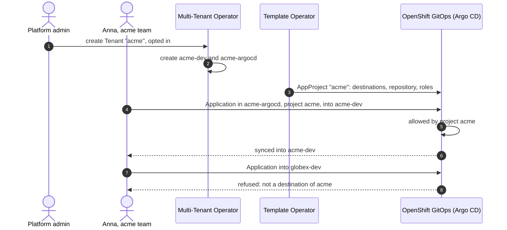

# One tenant, from OpenShift to Argo CD

<!--
Outlet: Red Hat Developer (explainer), then the Stakater blog, canonical link back.
Its tutorial is post 6, "Hands-on: tenants on OpenShift, carried into Argo CD".
Authors: Ayesha Arshad (Stakater), Rasheed Amir (Stakater), Raffaele Spazzoli (Red Hat).
Target: 1,500 to 2,000 words.
Title options:
  - One tenant, from OpenShift to Argo CD
  - Every team its own Argo CD project, automatically
  - GitOps for every team on one OpenShift GitOps, without the tickets
-->

A platform team runs one Argo CD, through Red Hat OpenShift GitOps, for forty
application teams. Every team wants the same thing: deploy its own services
from its own Git repository, into its own projects, without opening a
ticket. And every team must be kept away from the others, and from Argo CD
itself.

Argo CD has the right tool for this: the **AppProject**. A project says which
repositories a team may deploy from, which namespaces it may deploy into,
and who may do what. But nothing creates a project from the platform's idea
of a team. So the platform team writes each one by hand, and edits it again
whenever the team gains a namespace, a repository or a person.

This article shows a different approach. You define each team once, on the
cluster, as a **tenant**, and Argo CD follows. Every tenant gets its own
AppProject: its namespaces as destinations, its repositories, and roles for
its people. The project stays in step as the tenant changes, and the team
deploys on its own, without ever touching Argo CD's control plane.

The tenant comes from **Multi-Tenant Operator**, a Red Hat certified operator
from Stakater. It's a commercial product, with a free Basic edition that
manages up to two tenants, with no expiry. Argo CD runs as Red Hat OpenShift
GitOps, and stays in charge of every decision.

**In this article:**

- what giving one team its own Argo CD project takes today, and where that
  breaks down
- the tenant, and how one tenant becomes one AppProject
- how it works, and how teams deploy on their own
- what each team sees in Argo CD
- the guardrails Argo CD owners and security teams will ask about

**Who it's for:** platform engineers and architects who run Argo CD or
OpenShift GitOps for many teams, and the people who own Argo CD and its
security. You should know Argo CD's basics: Applications, projects and
syncs. If Multi-Tenant Operator is new to you, this is a good place to meet
it: the article introduces it from the ground up. You don't need the earlier
articles in this series.

**Want to build it?** The companion tutorial,
[Hands-on: tenants on OpenShift, carried into Argo CD](https://github.com/stakater/mto-blogs/tree/main/06-try-it-tenants-and-argocd),
takes you through every step on your own cluster. This article explains the
why and the how, so you know what you're building.

## What one team costs in Argo CD

Here's the project for one team, `acme`, with two namespaces and one
repository, written by hand:

```yaml
apiVersion: argoproj.io/v1alpha1
kind: AppProject
metadata:
  name: acme
  namespace: openshift-gitops
spec:
  sourceRepos:
    - https://github.com/acme-org/acme-gitops
  destinations:
    - server: https://kubernetes.default.svc
      namespace: acme-dev
    - server: https://kubernetes.default.svc
      namespace: acme-prod
  roles:
    - name: acme-owner
      groups: [acme-owners]
      policies:
        - p, proj:acme:acme-owner, applications, *, acme/*, allow
        - p, proj:acme:acme-owner, logs, get, acme/*, allow
    - name: acme-view
      groups: [acme-viewers]
      policies:
        - p, proj:acme:acme-view, applications, get, acme/*, allow
```

That's one team, on day one. Then it has to be **kept** right:

- The team adds `acme-test`. Until someone edits the project, the team can't
  deploy there.
- Someone joins, moves or leaves. Their access has to change in every
  project they touch, and be undone later.
- The team needs an exception, such as a release freeze in production. Someone
  edits that one project by hand, and nobody remembers to undo it.
- A namespace is retired, or the team stops using Argo CD. Every reference
  has to go, or access is left behind.
- And every project must keep Argo CD's own namespace out, and keep teams from
  deploying what the platform owns, such as their own quotas. Get it wrong in
  one project, and that team has more power than it should.

Multiply that by forty teams. Platform teams end up in one of three places:

- **One shared project.** Quick, and every team can deploy anywhere, from
  any repository.
- **Projects by hand.** Safe on day one. By Friday, the new namespace isn't
  a destination, and last quarter's team can still deploy.
- **Applications only in Argo CD's own namespace.** Teams need write access
  to Argo CD's control plane to deploy, and that is Argo CD admin.

## The idea: one tenant, one project

Multi-Tenant Operator adds the object that's missing: a `Tenant` is the team.
It names the team's namespaces and its people, and Multi-Tenant Operator
keeps the cluster in line with it.

The Argo CD extension for Multi-Tenant Operator turns that tenant into an
AppProject. To opt a tenant in, you add one annotation:

```yaml
apiVersion: tenantoperator.stakater.com/v1beta3
kind: Tenant
metadata:
  name: acme
  annotations:
    argocd.tenantoperator.stakater.com/enabled: "true"
spec:
  accessControl:
    owners:
      groups: [acme-owners]
  namespaces:
    withTenantPrefix:
      - dev
      - prod
```

Within moments, Argo CD has a project `acme`, built from that tenant and
kept in step with it:

| By hand, per team | With Multi-Tenant Operator |
|---|---|
| Write an AppProject | Created when the tenant is opted in, named after it |
| List the team's namespaces as destinations | The tenant's namespaces, always; a new namespace becomes a destination on its own |
| List the team's repositories | From one pattern for every tenant, such as `https://github.com/acme-org/{{ tenant }}-gitops` |
| Write a role and policy per access level | Owner, edit and view roles, least privilege, bound to the tenant's owners, editors and viewers |
| Change roles when people join, move or leave | Nothing to change: the roles name the tenant's groups, so a group change is enough |
| Keep Argo CD's own namespace out of reach | Never a destination, for any tenant |
| Keep teams from deploying what the platform owns | Kinds such as `ResourceQuota` denied in every project |
| Hand-edit one team's project for an exception | An annotation on that team's tenant: a sync window, an extra repository, extra kinds. Removed the same way. |
| Clean up when a namespace or a team goes | The destination is removed; a team leaving Argo CD has its project released, not deleted |
| Keep it all right as the team changes | Re-rendered on every change to the tenant or its namespaces. A hand edit is refused. |

Nobody writes or edits an AppProject.

## How it works

The extension runs no controller of its own. It's a Helm chart that gives
Template Operator, which ships with Multi-Tenant Operator, one template: an
AppProject per tenant. Argo CD then enforces the project, exactly as it
enforces any other.

| Component | Role |
|---|---|
| **Multi-Tenant Operator** | Owns the `Tenant`: its namespaces and its people |
| **Template Operator** | Ships with Multi-Tenant Operator. Renders one AppProject per opted-in tenant, and refuses hand edits |
| **Red Hat OpenShift GitOps** | Argo CD. Enforces each project: where a team may deploy, from where, and who may do what |



### Teams deploy on their own, outside the control plane

By default, Argo CD keeps every Application in its own namespace, and anyone
who can write there can point an Application at any project. That's why
teams usually can't create their own Applications, and the platform team
does it for them.

Argo CD can also read Applications from other namespaces, and the extension
uses that. Each tenant declares a namespace for its Applications in its
`Tenant`, such as `acme-argocd`, like any of its other namespaces. Multi-Tenant
Operator creates it, and the extension makes it the only place that tenant's
project accepts Applications from. The team creates,
changes and deletes its own Applications there with the access Multi-Tenant
Operator already gives it, and never needs write access to Argo CD's own
namespace.

## What each team sees

Anna, on the `acme` team, signs in to Argo CD with her OpenShift account. She
sees her team's Applications, and nothing from any other team:

> 📷 **Screenshot to capture** (`06-argocd-anna-apps.png`, from the tutorial): Argo CD as Anna: the Application `hello` in project `acme`, Synced and Healthy.
> **Highlight:** the Application `hello`, and its project `acme`.

When she points an Application at another team's namespace, Argo CD refuses
it and says why:

> 📷 **Screenshot to capture** (`08-argocd-refused.png`, from the tutorial): Argo CD as Anna: an Application targeting `globex-dev`, with the error that the destination isn't permitted in project `acme`.
> **Highlight:** the error message.

## Guardrails for Argo CD owners

Argo CD owners and security teams will ask what this setup can do. The
answers:

- **Argo CD's own namespace is never a destination.** An Application that
  deploys into Argo CD's namespace can create projects, Applications and
  repository credentials for every team, which amounts to Argo CD admin. No
  tenant's project ever lists it, even if someone labels it for a tenant.
- **Roles are least privilege.** Owners manage their team's Applications.
  Editors can sync and update them, but not create, delete or override them.
  Viewers can only look. No role gets Argo CD's web terminal or can register
  a cluster, unless you switch that on.
- **Teams stay inside their own boundary.** A team's project lists only its
  own namespaces and its own repositories, and Applications in its own
  namespace can only use its own project.
- **Hand edits are refused.** If someone edits a managed project directly,
  the change is refused, so a project can't quietly drift from its tenant.
- **Mistakes stay small.** A tenant with a malformed setting fails on its
  own; every other tenant's project still renders. Taking a tenant out of
  Argo CD releases its project rather than deleting it.

These are covered by the extension's tests, on upstream Argo CD 3.5. The
tutorial runs the same checks on OpenShift GitOps 1.22.

Two things are worth agreeing before production. Repositories come from a
pattern, so give each tenant its own, such as `{{ tenant }}-gitops`: one
shared repository would let every team deploy every other team's code. And
roles follow the tenant's groups, so whoever manages those groups decides
who can deploy for the team.

For stricter environments, the extension can also make Argo CD sync as a
service account in the team's own namespace, so a sync can only do what the
team itself could. That uses Argo CD 3.5's sync impersonation, which is
still beta in Argo CD, and is off by default.

## Try it

Multi-Tenant Operator's Basic edition is free with no expiry, and manages up
to two tenants. That's enough to see two teams on one Argo CD, each deploying
on its own and refused in the other's space, and to watch people, namespaces,
exceptions and a team leaving, all handled without editing a project.

The companion tutorial,
[Hands-on: tenants on OpenShift, carried into Argo CD](https://github.com/stakater/mto-blogs/tree/main/06-try-it-tenants-and-argocd),
takes you from an OpenShift cluster to two teams deploying with Argo CD,
each inside its own project, in about 90 minutes.

## What's next

Argo CD deploys what a team builds. Next in this series, the same tenant
follows the team into the tools that watch what it runs.

## About Multi-Tenant Operator

Multi-Tenant Operator, from Stakater, turns a shared OpenShift cluster into
a platform of tenants. Each team is defined once, and that boundary reaches
its projects, its access, its quotas, its costs and, through extensions,
tools such as Argo CD and Vault. It's a Red Hat certified operator, available
in OperatorHub.

- **Try it free:** the Basic edition manages up to two tenants, with no
  expiry and no capability held back.
- **Learn more:** [docs.stakater.com/mto](https://docs.stakater.com/mto/)
- **Running more than two teams?** Multi-Tenant Operator Enterprise adds
  unlimited tenants and a support commitment. Contact
  [sales@stakater.com](mailto:sales@stakater.com).

---

*Ayesha Arshad, Stakater. Rasheed Amir, Stakater. Raffaele Spazzoli, Red Hat.*
