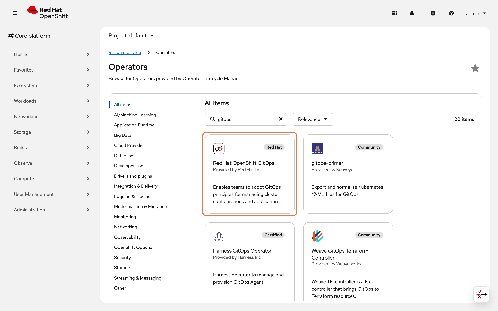
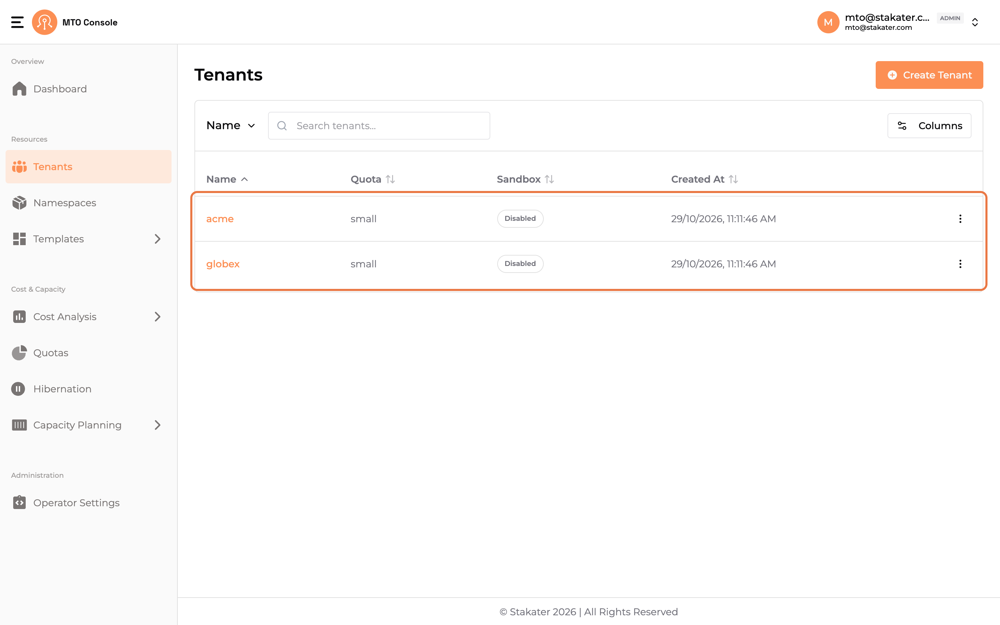
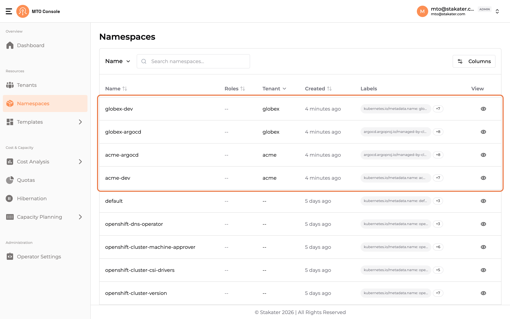
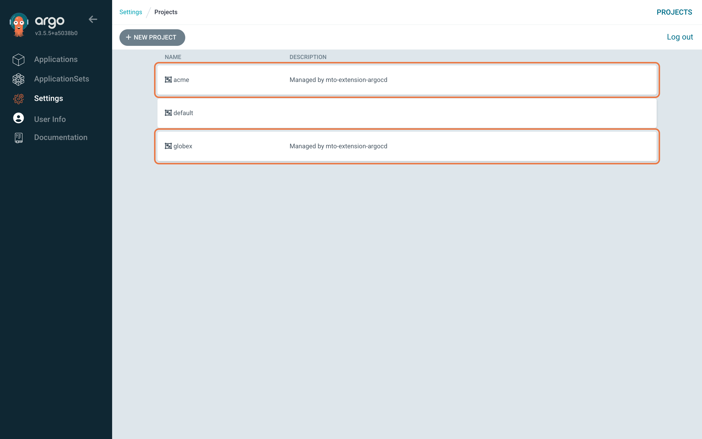
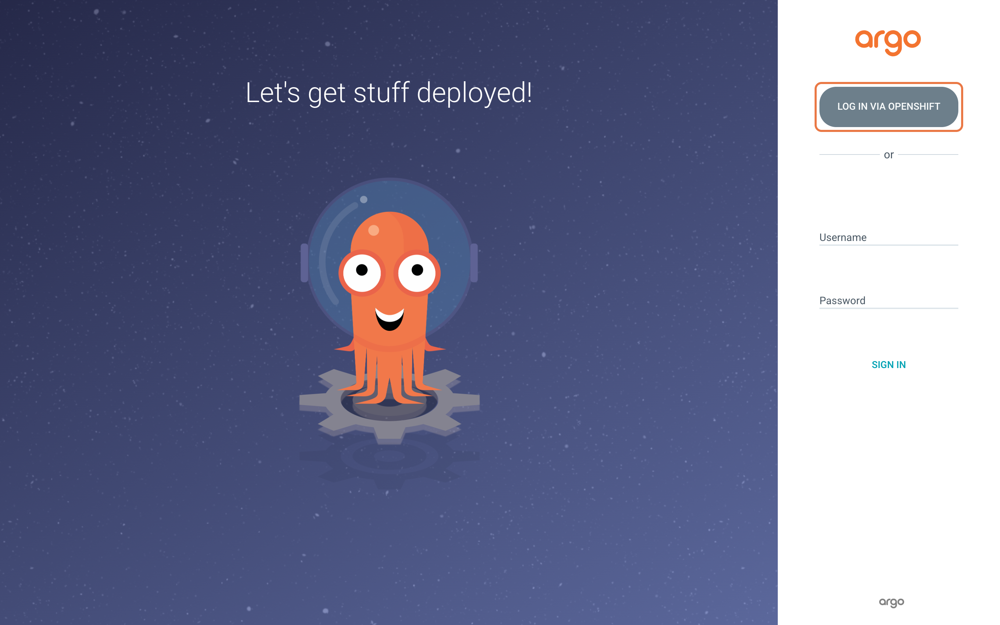

# Hands-on: tenants on OpenShift, carried into Argo CD

<!--
Outlet: Red Hat Developer (tutorial), then the Stakater blog, canonical link back.
Companion to post 5, "One tenant, from OpenShift to Argo CD", which explains why.
Screenshots: each "Screenshot to capture" block is a slot, filled during the
validation run. The full list, with highlights, is in screenshots/README.md.
-->

In [One tenant, from OpenShift to Argo CD](../05-tenants-and-argocd/post.md),
we showed how a team defined once on OpenShift, as a tenant, gets its own
AppProject, kept in step with the team. This tutorial builds it, step by
step.

By the end you'll have:

- two tenants, `acme` and `globex`, each with its own AppProject, created
  and kept up to date by Multi-Tenant Operator
- Anna, on the `acme` team, deploying her team's app by GitOps, on her own,
  without access to Argo CD's control plane
- proof that Argo CD refuses anything outside her team's boundary: another
  team's namespace, repository or AppProject, Argo CD's own namespace, and the
  quota Multi-Tenant Operator sets
- people joining and leaving a team, a namespace added and removed, a
  release freeze for one team, and a team leaving Argo CD, each handled with
  one change and no edit to any AppProject

Allow about 90 minutes.

## Before you start

You need:

- An OpenShift 4 cluster, and `cluster-admin` on it
- `oc`, `helm` and `htpasswd` on your machine. `htpasswd` comes with macOS;
  on Linux it's in the `httpd-tools` or `apache2-utils` package.
- A private browser window, for signing in as Anna
- The example files:

  ```bash
  git clone https://github.com/stakater/mto-blogs.git
  cd mto-blogs/06-try-it-tenants-and-argocd/examples
  ```

Here's what you'll install:

| Component | Version | From | Job |
|---|---|---|---|
| Multi-Tenant Operator | 1.10.0 or later | Software Catalog (OperatorHub) | Owns the tenants, and runs Template Operator |
| Red Hat OpenShift GitOps | 1.22 (Argo CD 3.5) | Software Catalog (OperatorHub) | Argo CD: deploys from Git, and enforces each AppProject |
| Argo CD extension for Multi-Tenant Operator | 0.7.1 | `oci://ghcr.io/stakater/charts` | Turns each tenant into an AppProject |

Each tenant deploys from its own Git repository. This tutorial uses two
small public ones, so you don't need a Git account:
[stakater/mto-blogs-acme-gitops](https://github.com/stakater/mto-blogs-acme-gitops)
and [stakater/mto-blogs-globex-gitops](https://github.com/stakater/mto-blogs-globex-gitops).
Each holds a small web server; the same files are in
[`examples/gitops/`](examples/gitops/).

The Multi-Tenant Operator Basic edition is free with no expiry, and manages
up to two tenants. That's exactly what this tutorial uses.

## Step 1: Install Multi-Tenant Operator

If you followed the [Vault tutorial](../02-try-it-tenants-and-vault-enterprise/post.md)
on this cluster, Multi-Tenant Operator and Template Operator are already
running: set `TOP_NS` and `TOP_SA` as below, and go to step 2.

In the OpenShift console, go to **Ecosystem → Software Catalog** (on older
versions, **Operators → OperatorHub**), search for **multi tenant**, and
install **Multi Tenant Operator** with the defaults. It installs into the
`multi-tenant-operator` namespace.

Switch on the Template Operator it ships with, and its console:

```bash
oc -n multi-tenant-operator patch integrationconfig tenant-operator-config --type merge -p '{
  "spec": {
    "components": {"templateOperatorV2": {"mode": "Managed"}, "console": true, "showback": true},
    "accessControl": {"privileged": {"users": ["mto@stakater.com"]}}
  }}'
```

When Template Operator is running, note the namespace and ServiceAccount it
runs as. The extension needs both in step 4:

```bash
oc get deploy -A -o custom-columns=NAMESPACE:.metadata.namespace,NAME:.metadata.name,SA:.spec.template.spec.serviceAccountName \
  | grep template-operator-v2

export TOP_NS=<namespace from the output>
export TOP_SA=<ServiceAccount from the output>
```

OpenShift GitOps runs in `openshift-gitops`, which Multi-Tenant Operator
already treats as privileged, like every `openshift-*` namespace. Nothing
else to configure.

## Step 2: Install Red Hat OpenShift GitOps

In **Ecosystem → Software Catalog**, search for **gitops** and install
**Red Hat OpenShift GitOps** with the defaults.



The operator creates an Argo CD instance in `openshift-gitops`. Wait for it:

```bash
oc -n openshift-gitops wait deploy/openshift-gitops-server --for=condition=Available --timeout=600s
```

By default, Argo CD reads Applications only from its own namespace. Let it
read them from every namespace ending in `-argocd`, where each team will
keep its own:

```bash
oc -n openshift-gitops patch argocd openshift-gitops --type merge \
  -p '{"spec":{"sourceNamespaces":["*-argocd"]}}'

oc -n openshift-gitops rollout status deploy/openshift-gitops-server --timeout=300s
oc -n openshift-gitops rollout status statefulset/openshift-gitops-application-controller --timeout=300s
```

**What just happened:** Argo CD now looks for Applications in any namespace
whose name ends in `-argocd`. That alone grants nothing: each team's AppProject
still decides which of those namespaces it accepts, and the extension lists
only the team's own.

## Step 3: Add three people

Anna owns `acme`, and Ben owns `globex`. Carl isn't on a team yet; he joins
one in step 8. Create all three as OpenShift users, with a password file, and
create each team's groups: one for owners, one for viewers.

```bash
ANNA_PASSWORD=$(openssl rand -hex 8)
BEN_PASSWORD=$(openssl rand -hex 8)
CARL_PASSWORD=$(openssl rand -hex 8)
htpasswd -c -B -b users.htpasswd anna "$ANNA_PASSWORD"
htpasswd -B -b users.htpasswd ben "$BEN_PASSWORD"
htpasswd -B -b users.htpasswd carl "$CARL_PASSWORD"
oc -n openshift-config create secret generic tutorial-users --from-file=htpasswd=users.htpasswd
rm users.htpasswd

IDP='{"name":"tutorial","mappingMethod":"claim","type":"HTPasswd","htpasswd":{"fileData":{"name":"tutorial-users"}}}'
if [ -n "$(oc get oauth cluster -o jsonpath='{.spec.identityProviders}')" ]; then
  oc patch oauth cluster --type json -p "[{\"op\":\"add\",\"path\":\"/spec/identityProviders/-\",\"value\":$IDP}]"
else
  oc patch oauth cluster --type json -p "[{\"op\":\"add\",\"path\":\"/spec/identityProviders\",\"value\":[$IDP]}]"
fi
sleep 30
oc wait clusteroperator authentication --for=condition=Progressing=False --timeout=600s

oc adm groups new acme-owners anna
oc adm groups new acme-viewers
oc adm groups new globex-owners ben
oc adm groups new globex-viewers

echo "anna: $ANNA_PASSWORD   ben: $BEN_PASSWORD   carl: $CARL_PASSWORD"
```

Note the passwords. You'll sign in as Anna in step 6, and as Carl in step 8.

**In production,** people and groups come from your identity provider, not a
password file. The
[one-login tutorial](../04-try-it-one-login-for-tenant-members/post.md) in
this series connects one; Argo CD on OpenShift GitOps signs people in through
OpenShift, so it picks up the same groups.

## Step 4: Install the Argo CD extension

[`values.yaml`](examples/values.yaml) holds the extension's settings: Argo
CD's namespace, a repository pattern that gives each tenant its own
repository, and Applications in each tenant's own `<tenant>-argocd`
namespace.

```bash
helm upgrade --install mto-extension-argocd \
  oci://ghcr.io/stakater/charts/mto-extension-argocd --version 0.7.1 \
  -n multi-tenant-operator -f values.yaml \
  --set rbac.serviceAccount.name="$TOP_SA" \
  --set rbac.serviceAccount.namespace="$TOP_NS"
```

**What just happened:** the extension gave Template Operator one template:
an AppProject per tenant. It acts only on tenants that opt in with an
annotation, and there are none yet, so Argo CD hasn't changed.

**In production,** keep the repository pattern templated on the tenant, as
it is here. A single shared repository would let every team deploy every
other team's code.

## Step 5: Create two tenants

[`tenants.yaml`](examples/tenants.yaml) defines two teams. Each opts in to
Argo CD with one annotation, names its owners' and viewers' groups, and gets
two namespaces: one for its workloads, and one for its Argo CD Applications.

```yaml
apiVersion: tenantoperator.stakater.com/v1beta3
kind: Tenant
metadata:
  name: acme
  annotations:
    argocd.tenantoperator.stakater.com/enabled: "true"
spec:
  quota: small
  accessControl:
    owners:
      groups: [acme-owners]
    viewers:
      groups: [acme-viewers]
  namespaces:
    withTenantPrefix:
      - dev
      - argocd
```

```bash
oc apply -f tenants.yaml
```

Multi-Tenant Operator creates `acme-dev`, `acme-argocd`, `globex-dev` and
`globex-argocd`. Within moments, Argo CD has an AppProject for each tenant:

```bash
oc -n openshift-gitops get appprojects
```

```
NAME      AGE
acme      20s
default   15m
globex    20s
```

Look at what `acme`'s AppProject allows:

```bash
oc -n openshift-gitops get appproject acme -o jsonpath='
destinations: {.spec.destinations[*].namespace}
repository:   {.spec.sourceRepos}
applications from: {.spec.sourceNamespaces}
roles:        {.spec.roles[*].name}
'
```

```
destinations: acme-argocd acme-dev
repository:   ["https://github.com/stakater/mto-blogs-acme-gitops"]
applications from: ["acme-argocd"]
roles:        acme-owner acme-edit acme-view
```

Only acme's namespaces, only acme's repository, and Applications only from
acme's own namespace. `openshift-gitops` is never a destination.

In Multi-Tenant Operator's console, the **Tenants** page shows both teams.
Open the console's route, and sign in as `mto@stakater.com` with the password
Multi-Tenant Operator generated:

```bash
oc -n multi-tenant-operator get routes | grep console
oc -n multi-tenant-operator get secret tenant-operator-console-credentials \
  -o jsonpath='{.data.passwordPlainText}' | base64 -d; echo
```





**In production,** connect your identity provider and delete this built-in
account: anyone who can read Secrets in `multi-tenant-operator` can read its
password, and it sees every tenant.

In Argo CD, as an administrator, the AppProjects are listed under **Settings →
Projects**. Open Argo CD and sign in with **Log in via OpenShift**, as your
`cluster-admin` user:

```bash
echo "https://$(oc -n openshift-gitops get route openshift-gitops-server -o jsonpath='{.spec.host}')"
```



**In production,** Tenants belong to the platform team: a team can't edit its
own. On most platforms they live in Git, like the rest of the platform's
configuration, so a team proposes a change to its tenant (a new namespace, a
new member group, an exception) as a pull request to the platform's
repository. The platform team reviews and merges it, and everything in this
tutorial follows from there. Here you apply tenants with `oc`, to keep it
short.

**What just happened:** you created two tenants and didn't touch Argo CD.
Template Operator rendered an AppProject for each, from the tenant's namespaces
and owners, and keeps it in step with the tenant from now on.

## Step 6: Anna deploys her team's app

Anna signs in to Argo CD with her OpenShift account. In the private browser
window, open Argo CD, choose **Log in via OpenShift**, then the **tutorial**
identity provider, and sign in as `anna`.



She has no Applications yet. She creates one from her terminal, in her
team's own namespace for Applications. Give her a separate login, so your
own stays as it is:

```bash
API=$(oc whoami --show-server)
oc login "$API" -u anna -p "$ANNA_PASSWORD" --kubeconfig anna.kubeconfig
anna() { oc --kubeconfig anna.kubeconfig "$@"; }
```

If your cluster's API certificate isn't trusted on your machine, add
`--insecure-skip-tls-verify` to the `oc login`, for this learning setup
only.

[`acme-app.yaml`](examples/acme-app.yaml) deploys acme's repository into
`acme-dev`, and keeps it in sync:

```yaml
apiVersion: argoproj.io/v1alpha1
kind: Application
metadata:
  name: hello
  namespace: acme-argocd
spec:
  project: acme
  source:
    repoURL: https://github.com/stakater/mto-blogs-acme-gitops
    targetRevision: main
    path: .
  destination:
    server: https://kubernetes.default.svc
    namespace: acme-dev
  syncPolicy:
    automated:
      selfHeal: true
```

```bash
anna apply -f acme-app.yaml
sleep 30
anna -n acme-argocd get application hello -o jsonpath='{.status.sync.status} {.status.health.status}{"\n"}'
anna -n acme-dev get pods
```

```
Synced Healthy
NAME                     READY   STATUS    RESTARTS   AGE
hello-6d9c8f7b5d-x2k4p   1/1     Running   0          25s
```

In Argo CD, Anna now sees her Application, in AppProject `acme`, and nothing
from any other team:

> 📷 **Screenshot to capture** (`06-argocd-anna-apps.png`): Argo CD as Anna: the Application hello in AppProject acme, Synced and Healthy.
> **Highlight:** the Application `hello`, and its AppProject `acme`.

> 📷 **Screenshot to capture** (`07-argocd-hello-synced.png`): Argo CD as Anna: the Application hello opened, its resource tree with the Deployment, ReplicaSet, Pod and Service, all healthy.
> **Highlight:** the Synced and Healthy status.

**What just happened:** Anna is in `acme-owners`, so Multi-Tenant Operator
gave her `admin` in acme's namespaces, which is how she could create an
Application in `acme-argocd`. Argo CD read it from there, checked it against
AppProject `acme` (the namespace it came from, the repository, the
destination), and synced it. Anna never had access to `openshift-gitops`.

## Step 7: Check the boundary

Now Anna tries to cross her team's boundary, five ways.
[`refused.yaml`](examples/refused.yaml) holds five Applications:

| Application | Tries to |
|---|---|
| `wrong-destination` | deploy into globex's namespace |
| `wrong-repository` | deploy from globex's repository |
| `wrong-project` | use globex's AppProject |
| `control-plane` | deploy into Argo CD's own namespace, which would amount to Argo CD admin |
| `own-quota` | deploy a `ResourceQuota`, raising the quota Multi-Tenant Operator sets for acme |

```bash
anna apply -f refused.yaml
sleep 30
for a in wrong-destination wrong-repository wrong-project control-plane own-quota; do
  echo "$a: $(anna -n acme-argocd get application $a \
    -o jsonpath='{.status.conditions[0].message}{.status.operationState.message}')"
done
```

```
wrong-destination: application destination server 'https://kubernetes.default.svc' and namespace 'globex-dev' do not match any of the allowed destinations in project 'acme'
wrong-repository: application repo https://github.com/stakater/mto-blogs-globex-gitops is not permitted in project 'acme'
wrong-project: app is not allowed in project "globex", or the project does not exist
control-plane: application destination server 'https://kubernetes.default.svc' and namespace 'openshift-gitops' do not match any of the allowed destinations in project 'acme'
own-quota: one or more synchronization tasks are not valid: resource :ResourceQuota is not permitted in project acme
```

Argo CD refuses all five, and deploys none of them. In the Argo CD UI, Anna
sees why:

> 📷 **Screenshot to capture** (`08-argocd-refused.png`): Argo CD as Anna: the Application wrong-destination, with the error that globex-dev isn't an allowed destination in AppProject acme.
> **Highlight:** the error message.

She can't go around Argo CD either: she has no access to globex's namespace
for Applications, or to Argo CD's own.

```bash
anna auth can-i create applications.argoproj.io -n globex-argocd
anna auth can-i create applications.argoproj.io -n openshift-gitops
```

```
no
no
```

Remove the five:

```bash
anna delete -f refused.yaml
```

**What just happened:** Argo CD enforced acme's AppProject, and every rule in
it came from the tenant: its namespaces, its repository, its namespace for
Applications, Argo CD's namespace left out, and the kinds Multi-Tenant
Operator owns denied. By hand, every one of those has to be right in every
team's AppProject, and one mistake in one AppProject is enough.

## Step 8: People join and leave

Carl joins acme, to keep an eye on its releases. He needs to see the team's
applications, not change them. Add him to acme's viewers group, and nothing
else:

```bash
oc adm groups add-users acme-viewers carl
```

Give Carl a login, and see what he can do:

```bash
oc login "$API" -u carl -p "$CARL_PASSWORD" --kubeconfig carl.kubeconfig
carl() { oc --kubeconfig carl.kubeconfig "$@"; }

carl -n acme-argocd get applications
carl -n acme-argocd delete application hello
```

```
NAME    SYNC STATUS   HEALTH STATUS
hello   Synced        Healthy
Error from server (Forbidden): applications.argoproj.io "hello" is forbidden: User "carl" cannot delete resource "applications" in API group "argoproj.io" in the namespace "acme-argocd"
```

In a new private window, sign in to Argo CD as `carl`. He sees acme's
Application, and Argo CD refuses to let him sync or delete it.

> 📷 **Screenshot to capture** (`08b-argocd-carl-viewer.png`): Argo CD as Carl: the Application hello in AppProject acme, with a permission error after trying to sync it.
> **Highlight:** the Application `hello`, and the permission error.

Each of the tenant's groups gets one level of access in its AppProject, least
privilege by default:

| Group in the tenant | Argo CD role | Can |
|---|---|---|
| owners | `acme-owner` | Create, change, sync and delete the team's Applications |
| editors | `acme-edit` | Sync and update Applications, but not create, delete or override them |
| viewers | `acme-view` | Look, and nothing else |

No role gets Argo CD's web terminal or can register a cluster, unless the
platform team switches that on.

Now Carl moves on. Take him out of the group:

```bash
oc adm groups remove-users acme-viewers carl
carl -n acme-argocd get applications
```

```
Error from server (Forbidden): applications.argoproj.io is forbidden: User "carl" cannot list resource "applications" in API group "argoproj.io" in the namespace "acme-argocd"
```

Argo CD reads Carl's groups when he signs in, so the next time he does, acme
is gone. To end a session straight away, as a leaver process would, delete
his OpenShift sessions:

```bash
oc get oauthaccesstokens -o custom-columns=NAME:.metadata.name,USER:.userName --no-headers \
  | awk '$2=="carl" {print $1}' | xargs -r oc delete oauthaccesstokens
```

**What just happened:** you changed one group, twice. Multi-Tenant Operator
gave Carl, then took away, his access to acme's namespaces, and acme's
AppProject already named the group, so Argo CD followed. Nobody edited a
AppProject. By hand, every person joining or leaving means editing the roles of
every AppProject they touch, and remembering to undo it.

## Step 9: The team grows

`acme` needs a production namespace. In practice the team would ask for it
with a pull request to the platform's repository. Here you add it to the
tenant directly, as a platform administrator:

```bash
oc patch tenant acme --type json \
  -p '[{"op":"add","path":"/spec/namespaces/withTenantPrefix/-","value":"prod"}]'
sleep 20
oc -n openshift-gitops get appproject acme -o jsonpath='{.spec.destinations[*].namespace}{"\n"}'
```

```
acme-argocd acme-dev acme-prod
```

> 📷 **Screenshot to capture** (`09-argocd-project-destinations.png`): Argo CD as an administrator, Settings → Projects → acme: the destinations acme-argocd, acme-dev and acme-prod.
> **Highlight:** the destination `acme-prod`.

Anna deploys to production straight away, with
[`acme-prod-app.yaml`](examples/acme-prod-app.yaml):

```bash
anna apply -f acme-prod-app.yaml
sleep 30
anna -n acme-argocd get application hello-prod -o jsonpath='{.status.sync.status} {.status.health.status}{"\n"}'
```

```
Synced Healthy
```

**What just happened:** Multi-Tenant Operator created `acme-prod`, and
Template Operator added it to acme's AppProject. Nobody edited the AppProject, and
Anna didn't have to ask.

## Step 10: A release freeze for one team

acme is preparing a release and wants nothing to change in production for a
day. That's an exception for one team. acme asks for it with a pull request
that adds an annotation to its tenant, and the platform team approves it. It
goes on the **tenant**, never on the AppProject. Here you add it directly:

```bash
oc annotate tenant acme --overwrite argocd.tenantoperator.stakater.com/sync-windows='[
  {"kind": "deny", "schedule": "0 0 * * *", "duration": "24h",
   "namespaces": ["acme-prod"], "description": "Release freeze"}]'
sleep 20
oc -n openshift-gitops get appproject acme -o jsonpath='{.spec.syncWindows[*].description}{"\n"}'
```

```
Release freeze
```

In Argo CD, Anna tries to sync `hello-prod`, and the freeze blocks it.
`hello`, in `acme-dev`, still syncs as usual.

> 📷 **Screenshot to capture** (`10-argocd-sync-window.png`): Argo CD as Anna: hello-prod, with its sync blocked by the "Release freeze" sync window.
> **Highlight:** the sync window and its message.

The release is out. Lift the freeze:

```bash
oc annotate tenant acme argocd.tenantoperator.stakater.com/sync-windows-
sleep 20
oc -n openshift-gitops get appproject acme -o jsonpath='{.spec.syncWindows}{"\n"}'
```

The output is empty: the window is gone.

**What just happened:** the exception lives on the tenant, and the AppProject
follows it, in and out. Other per-team exceptions work the same way, as
annotations on the tenant: an extra repository, extra kinds the team may
deploy, or keeping its AppProject if the tenant is ever deleted. By hand, an
exception is an edit to one team's AppProject that nobody remembers to undo.

## Step 11: The team shrinks, and a team leaves Argo CD

acme no longer needs `acme-prod`. Remove its Application, then the namespace
from the tenant:

```bash
anna delete -f acme-prod-app.yaml
oc patch tenant acme --type json \
  -p '[{"op":"remove","path":"/spec/namespaces/withTenantPrefix/2"}]'
sleep 20
oc -n openshift-gitops get appproject acme -o jsonpath='{.spec.destinations[*].namespace}{"\n"}'
```

```
acme-argocd acme-dev
```

`acme-prod` is no longer a destination: nothing can deploy there through
Argo CD any more.

Now `globex` stops using Argo CD. Take the annotation off its tenant:

```bash
oc annotate tenant globex argocd.tenantoperator.stakater.com/enabled-
sleep 20
oc -n openshift-gitops get appproject globex
```

```
NAME     AGE
globex   30m
```

The AppProject is still there. It's released: Multi-Tenant Operator no longer
manages it, and nothing that globex had running was torn down with it. The
platform team decides when to delete it.

**What just happened:** removing a namespace removed it from the AppProject,
and taking a team out of Argo CD released its AppProject instead of deleting
it. By hand, every removal means finding and cleaning every reference, and a
missed one leaves access behind.

## Step 12: Hand edits are refused

Someone tries to give `acme` access to globex's namespace by editing the
AppProject directly:

```bash
oc -n openshift-gitops patch appproject acme --type json \
  -p '[{"op":"add","path":"/spec/destinations/-","value":{"server":"https://kubernetes.default.svc","namespace":"globex-dev"}}]'
```

```
Error from server (Forbidden): admission webhook "..." denied the request: ...
```

**What just happened:** the AppProject belongs to the tenant. Template Operator
refuses changes to it that don't come from the tenant, so an AppProject can't
quietly drift from its team. To change what a team may do, change the
tenant.

## Clean up

Remove things in this order:

```bash
# Anna's Application, and the logins
anna delete -f acme-app.yaml
rm anna.kubeconfig carl.kubeconfig

# The tenants, then the extension. Their AppProjects are released,
# not deleted, so delete those last.
oc delete -f tenants.yaml
helm uninstall mto-extension-argocd -n multi-tenant-operator
oc -n openshift-gitops delete appproject acme globex

# The three people
oc delete group acme-owners acme-viewers globex-owners globex-viewers
oc delete user anna ben carl
oc delete identity tutorial:anna tutorial:ben tutorial:carl
IDX=$(( $(oc get oauth cluster -o jsonpath='{range .spec.identityProviders[*]}{.name}{"\n"}{end}' \
  | grep -n -x tutorial | cut -d: -f1) - 1 ))
oc patch oauth cluster --type json -p "[{\"op\":\"remove\",\"path\":\"/spec/identityProviders/$IDX\"}]"
oc -n openshift-config delete secret tutorial-users
```

To remove OpenShift GitOps and Multi-Tenant Operator as well, uninstall them
from **Installed Operators**.

## What you built

Two teams, defined once on OpenShift, each with its own AppProject. Each
team deploys from its own repository into its own namespaces, from its own
namespace for Applications, and never touches Argo CD's control plane.

Here's everything you did, and what it took care of:

| You did | Multi-Tenant Operator did | By hand, for every team |
|---|---|---|
| Opted a tenant in, with one annotation | Created its AppProject: its namespaces, its repository, roles for its groups, its namespace for Applications | Write the AppProject, its roles and its policies |
| Nothing | Kept Argo CD's own namespace and the kinds Multi-Tenant Operator owns out of every AppProject | Get both right in every AppProject, every time |
| Added Carl to a group, then removed him | Gave him access in Argo CD and on the cluster, then took it away | Edit the roles of every AppProject he touches, and remember to undo it |
| Added a namespace | Made it a destination | Edit the AppProject |
| Asked for a release freeze, then lifted it | Added the sync window to that team's AppProject, then removed it | Edit one AppProject, and remember to undo it |
| Removed a namespace; took a team out of Argo CD | Removed the destination; released the AppProject | Find and clean every reference |
| Edited an AppProject by hand | Refused it | Notice the drift, if anyone ever does |

The free edition stops at two tenants. When a third team arrives, that's
where Multi-Tenant Operator Enterprise comes in.

## About Multi-Tenant Operator

Multi-Tenant Operator, from Stakater, turns a shared OpenShift cluster into
a platform of tenants. Each team is defined once, and that boundary reaches
its projects, its access, its quotas, its costs and, through extensions,
tools such as Argo CD and Vault. It's a Red Hat certified operator, available
in OperatorHub.

- **Try it free:** the Basic edition manages up to two tenants, with no
  expiry and no capability held back.
- **Learn more:** [docs.stakater.com/mto](https://docs.stakater.com/mto/)
- **Running more than two teams?** Multi-Tenant Operator Enterprise adds
  unlimited tenants and a support commitment. Contact
  [sales@stakater.com](mailto:sales@stakater.com).

---

*Ayesha Arshad, Stakater. Rasheed Amir, Stakater. Raffaele Spazzoli, Red Hat.*
