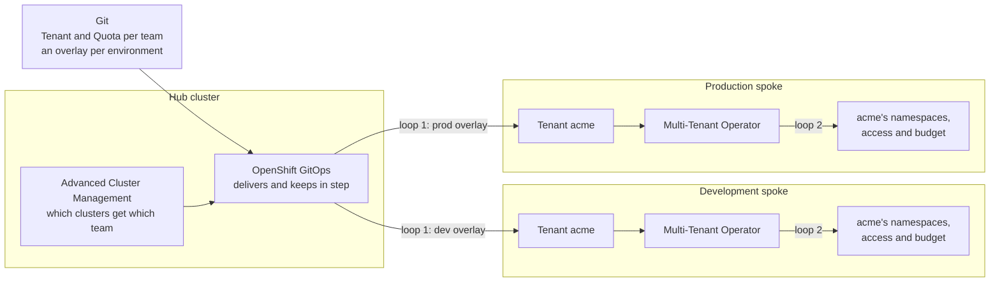

# One tenant, on every cluster

<!--
Outlet: Red Hat Developer (explainer), then the Stakater blog, canonical link back.
Its tutorial is post 8, "Hands-on: one tenant, on every cluster".
Authors: Ayesha Arshad (Stakater), Rasheed Amir (Stakater), Raffaele Spazzoli (Red Hat).
Target: 1,500 to 2,000 words.
Status: DRAFT, rewritten from story.md. Not validated on clusters. Every
"[To confirm: ...]" in the text is an open question from story.md; each one
is resolved, and its bracket removed, before review.
Title options:
  - One tenant, on every cluster
  - Tenancy for a fleet: one team, every OpenShift cluster
  - The hub knows your clusters. What knows your teams?
-->

A platform team runs a fleet of OpenShift clusters: a hub with Red Hat
Advanced Cluster Management, and a dozen spoke clusters for development,
production and each region. Forty application teams work across them. The
`acme` team builds on a development cluster and runs on two production ones.

The hub already knows every cluster, and can send configuration to any of
them. Yet tenancy is still done cluster by cluster. A team isn't one thing
the hub can send. It's a set of namespaces, role bindings, quotas and
network policies, copied to each cluster and kept in step there. And part of what a team needs can't
be sent at all, because it happens on the cluster, after the hub has done
its work: a team adds a namespace, and something has to give it the right
access, the right guardrails, and count it against the right budget.

This article shows a different split of the work. You define each team once,
in Git, as a **tenant**. The hub decides which clusters a team is on. On
each of those clusters, Multi-Tenant Operator turns the tenant into the
team's namespaces, access and budget, puts the platform's guardrails into
every one of those namespaces, and keeps it all right from then on.

The tenant comes from **Multi-Tenant Operator**, a Red Hat certified operator
from Stakater. It's a commercial product, with a free Basic edition that
manages up to two tenants, with no expiry. It runs on every spoke. The hub
is what you already run: Red Hat Advanced Cluster Management and Red Hat
OpenShift GitOps.

**In this article:**

- what one team costs across a fleet today, and where that breaks down
- the idea: the hub places a team, the tenant defines it, and one template
  guards it
- how it works, with two loops that keep each cluster right
- what the platform team sees on each cluster
- the guardrails a fleet owner will ask about

**Who it's for:** platform engineers and architects who run a hub and spoke
clusters for the same teams, and the people who own the fleet. You should
know OpenShift namespaces and RBAC, and have met Advanced Cluster Management
or OpenShift GitOps. If Multi-Tenant Operator is new to you, this is a good
place to meet it: the article introduces it from the ground up. You don't
need the earlier articles in this series.

**Want to build it?** The companion tutorial,
[Hands-on: one tenant, on every cluster](https://github.com/stakater/mto-blogs/tree/main/08-try-it-tenants-across-clusters),
takes you through every step on your own clusters. This article explains the
why and the how, so you know what you're building.

### Why this is a separate article

Earlier articles in this series carried one team into one more tool, such as
its secrets or its deployments, on a single cluster. This one is about the
cluster boundary itself: the same team on several clusters. It stands on its
own.

## What one team costs across a fleet

Here's the `acme` team on one cluster, as the objects the hub has to send.
The team has three namespaces, two groups of people, a budget, and the
platform's rule that a team's pods only accept traffic from their own team:

```
Namespace       acme-apps
RoleBinding     acme-apps/owners     group acme-owners   -> admin
RoleBinding     acme-apps/viewers    group acme-viewers  -> view
ResourceQuota   acme-apps/budget     a third of the team's budget
NetworkPolicy   acme-apps/same-team  traffic from acme and the router only

Namespace       acme-build
RoleBinding     acme-build/owners    group acme-owners   -> admin
RoleBinding     acme-build/viewers   group acme-viewers  -> view
ResourceQuota   acme-build/budget    a third of the team's budget
NetworkPolicy   acme-build/same-team traffic from acme and the router only

Namespace       acme-data
RoleBinding     acme-data/owners     group acme-owners   -> admin
RoleBinding     acme-data/viewers    group acme-viewers  -> view
ResourceQuota   acme-data/budget     a third of the team's budget
NetworkPolicy   acme-data/same-team  traffic from acme and the router only
```

That's fifteen objects for one team on one cluster. Forty teams on twelve
clusters would be 7,200. No team is on every cluster, so the real number is
smaller, and it's still thousands of objects that have to agree with each
other.

Nobody writes them one by one. Platform teams write a template that turns a
short list of teams into these objects, and the hub sends the result. That
works until the upkeep starts:

- **A team needs a namespace.** It's a pull request to the platform's
  repository, a review, and a wait, for something the team should be able to
  do within its own boundary. On every cluster the team is on.
- **A budget is split by hand.** The team has one budget, and it's divided
  between namespaces up front, or tied to them with a selector someone
  maintains. When the team's needs move, someone moves the numbers.
- **A new cluster joins.** Someone works out which teams belong on it and
  wires each one up.
- **Production differs,** in ways that live inside the template's
  conditions, where nobody reviewing a change can see them.

And it breaks quietly. A network policy edited on one cluster stays edited
until the next sync, or forever if that sync is manual. The template itself
has become a tenancy system that the platform team wrote, and now owns.

## The idea: the hub places, the tenant defines, a template guards

Multi-Tenant Operator adds the object that's missing: a `Tenant` is the
team. One object names the team's namespaces, its people and its budget, and
the operator on the cluster makes it so. Here's all of `acme`:

```yaml
apiVersion: tenantoperator.stakater.com/v1beta3
kind: Tenant
metadata:
  name: acme
spec:
  quota: acme-quota
  accessControl:
    owners:
      groups: [acme-owners]
    viewers:
      groups: [acme-viewers]
  namespaces:
    withTenantPrefix: [apps, build, data]
```

That definition is the same on every cluster, because the team is the same
team wherever it runs. What differs per environment is small and explicit.
The team lives in Git as a **base**, and each environment is an **overlay**
that changes only what differs, such as a larger budget in production:

```yaml
# overlays/prod: the same team, a larger budget
patches:
  - target: { kind: Quota, name: acme-quota }
    patch: |-
      - op: replace
        path: /spec/resourcequota/hard/requests.cpu
        value: "20"
```

The guardrails aren't part of any team, so they aren't in any tenant.
They're one **template** for the whole cluster. Multi-Tenant Operator ships
with Template Operator, which takes a template such as "in every namespace
that belongs to a tenant, this network policy, with that tenant's name in
it" and keeps it true. It watches the cluster's namespaces, so a namespace
that joins a team tomorrow gets the policy without anyone asking.

So the work splits in two. **The hub decides where a team exists:** which
clusters get `acme`, and with which overlay. **Multi-Tenant Operator decides
what a team is there:** it creates the namespaces, binds the groups, applies
the budget, writes the guardrails, and keeps doing so.

| The work | The hub | Multi-Tenant Operator, on each cluster |
|---|---|---|
| Put a team on a cluster | Sends one `Tenant` and its `Quota` | Creates the team's namespaces, access and budget from them |
| Put a team on the right clusters | Selects clusters by label | |
| Bring in a new cluster | One label, and its teams arrive | Builds each team on arrival |
| Make production differ | Sends the production overlay | |
| Add a person or a namespace for a team | Sends the changed `Tenant` | Updates every namespace of the team |
| Give a team one budget across its namespaces | | One `Quota` for the tenant [To confirm with engineering: the quota is one budget across all the tenant's namespaces, and tests cover it] |
| Let a team add a namespace on its own | | A tenant owner creates it; it joins the tenant, with its access and inside its budget [To confirm with engineering: this works when the `Tenant` is managed from Git, and the namespace survives the next sync] |
| Give every team's namespaces the platform's guardrails | Sends one template per cluster | Template Operator writes them into every tenant namespace, including ones created later |
| Undo a change made on the cluster | Puts back a changed `Tenant` | Puts back what's inside the tenant, and refuses a change to a guardrail |

The hub does what it's good at, and the homegrown template is gone. What
the hub sends for a team is two small objects, whatever the team's size. What
it sends for the guardrails is one template per cluster, however many teams
are on it.

## How it works

Nothing new runs between the clusters. Multi-Tenant Operator is installed on
each spoke and governs only that spoke.

| Component | Role |
|---|---|
| **Git** | Each team's `Tenant` and `Quota`, and an overlay per environment |
| **Red Hat Advanced Cluster Management**, on the hub | Knows the clusters and their labels, and decides which clusters each team is placed on |
| **Red Hat OpenShift GitOps**, on the hub | Delivers each team's definition to the clusters it's placed on, and keeps it in step with Git |
| **Multi-Tenant Operator**, on each spoke | Turns the tenant into namespaces, access and budget, and keeps them right |
| **Template Operator**, on each spoke | Ships with Multi-Tenant Operator. Writes the platform's guardrails into every tenant namespace, and refuses hand edits |

[To confirm with Raffaele: placement by Advanced Cluster Management with
delivery by OpenShift GitOps is the path Red Hat wants shown. If it's
Advanced Cluster Management policies, this table and the diagram change.]



Two loops keep a cluster right, and they cover different mistakes.

**Loop 1 runs from the hub.** If a `Tenant` on a spoke is changed or
deleted, the hub puts it back as Git has it.

**Loop 2 runs on the spoke.** If something inside the tenant is changed,
such as a role binding removed from one of the team's namespaces,
Multi-Tenant Operator puts it back. It doesn't need the hub for that. A
spoke that loses its link to the hub keeps every team's boundary in force,
and picks up changes from Git when the link returns.

**Guardrails don't need a loop.** A template can be strict: Template
Operator then refuses a change or a delete made by hand, at the moment it's
tried, and says which template owns the object.

Placement is a label. A team's definition says which clusters it belongs
on, such as every cluster labeled as development. When a new cluster joins
the hub and gets that label, its teams arrive, and Multi-Tenant Operator
builds each one and guards its namespaces. Nobody wires the cluster up team
by team.

## What the platform team sees

Multi-Tenant Operator has a console on each cluster. On a development
spoke, the Tenants page shows the teams placed there:

> 📷 **Screenshot to capture** (`02-mto-console-dev-tenants.png`): the Multi-Tenant Operator console on the development spoke, Tenants page, with `acme` and `globex`.
> **Highlight:** the row `acme`, with its quota.

On a production spoke, it's the same team with the production budget:

> 📷 **Screenshot to capture** (`03-mto-console-prod-tenants.png`): the Multi-Tenant Operator console on the production spoke, Tenants page, with `acme` and `globex`.
> **Highlight:** the row `acme`, with its larger quota.

The hub shows where each team has been placed, and whether each cluster is
in step with Git:

> 📷 **Screenshot to capture** (`04-hub-team-placements.png`): OpenShift GitOps on the hub, Applications, with `acme`, `globex` and the guardrails on each spoke, all Synced and Healthy.
> **Highlight:** the two Applications for `acme`, one per spoke.

## Guardrails for the fleet owner

The people who own the fleet will ask what this setup can do on their
clusters. The answers:

- **The hub needs very little on each spoke.** It delivers a `Tenant` and a
  `Quota` per team, and one template for the guardrails. The namespaces,
  role bindings and network policies are made on the spoke, by the
  operator. [To confirm in the
  validation run: the hub's access on a spoke can be limited to those
  kinds, and how.]
- **Whoever can merge decides what a team is.** A change to the base reaches
  every cluster the team is on. Keep the base with the platform team, and
  let teams propose changes as pull requests.
- **Guardrails can't be edited by hand.** A strict template refuses changes
  and deletes of what it wrote, for everyone but Template Operator itself.
  To change a guardrail, change the template in Git.
- **Templates are a control point.** Whoever can write a template can make
  Template Operator write anything it has the right to write. Keep templates
  with the platform team, and give Template Operator only the kinds your
  guardrails need.
- **The differences between environments are written down.** An overlay is
  the whole list of how an environment differs, and a mistake in one stays
  in its environment.
- **A spoke stands on its own.** Each cluster's operator works without the
  hub. If the hub is unreachable, no team loses its boundary.
- **Teams stay inside their tenant.** A tenant owner can act in the team's
  own namespaces, on the clusters the team is placed on, and nowhere else.

What isn't there: Multi-Tenant Operator has no view across the fleet. Each
installation knows its own cluster, and the fleet view is the hub's.

Two things are worth agreeing before production. Decide what belongs in the
base and what an overlay may change: a team's people belong in the base, so
access can't differ between clusters by accident. And decide which label
places a team, because whoever can label a cluster decides which teams run
on it.

## Try it

Multi-Tenant Operator's Basic edition is free with no expiry, and manages up
to two tenants. [To confirm: Basic is two tenants on each cluster, so two
teams on two spokes need no license.] That's enough to see two teams on two
clusters from one definition each, a cluster that gets its teams and their
guardrails from one label, and a boundary that's put back when it's broken.

You bring the clusters: a hub with Advanced Cluster Management and OpenShift
GitOps, and two spokes. The companion tutorial,
[Hands-on: one tenant, on every cluster](https://github.com/stakater/mto-blogs/tree/main/08-try-it-tenants-across-clusters),
takes you from there to both teams running on both spokes.

Today, what a team gets in other tools through an extension, such as a
Vault namespace or an Argo CD AppProject, belongs to one cluster. A team on
two clusters has one on each. Sharing one between clusters isn't supported
yet.

## What's next

A team defined once now reaches every cluster it belongs on. Later in this
series, the same tenant follows the team into more of the tools it uses.

## About Multi-Tenant Operator

Multi-Tenant Operator, from Stakater, turns a shared OpenShift cluster into
a platform of tenants. Each team is defined once, and that boundary reaches
its projects, its access, its quotas, its costs and, through extensions,
tools such as Argo CD and Vault. It's a Red Hat certified operator, available
in OperatorHub.

- **Try it free:** the Basic edition manages up to two tenants, with no
  expiry and no capability held back.
- **Learn more:** [docs.stakater.com/mto](https://docs.stakater.com/mto/)
- **Running more than two teams?** Multi-Tenant Operator Enterprise adds
  unlimited tenants and a support commitment. Contact
  [sales@stakater.com](mailto:sales@stakater.com).

---

*Ayesha Arshad, Stakater. Rasheed Amir, Stakater. Raffaele Spazzoli, Red Hat.*
