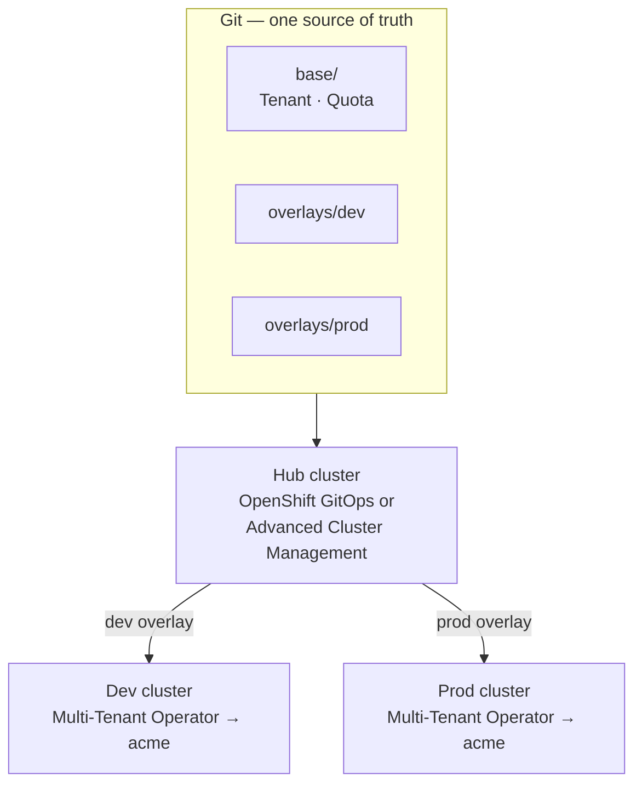

# One tenant, on every cluster

<!--
Outlet: Red Hat Developer (explainer), then the Stakater blog, canonical link back.
Its tutorial is post 8, "Hands-on: one tenant, on every cluster".
Authors: Ayesha Arshad (Stakater), Rasheed Amir (Stakater), Raffaele Spazzoli (Red Hat).
Target: 1,500 to 2,000 words.
Status: DRAFT. Not yet validated on clusters; see the tutorial for the gate.
Title options:
  - One tenant, on every cluster
  - The same team, the same way, on every OpenShift cluster
  - Define a team once, run it on every cluster
-->

A platform team runs more than one OpenShift cluster. There's a development
cluster and a production cluster, often a staging one between them, and
sometimes a cluster per region. The same application teams work across them:
the `acme` team builds on the development cluster and runs on the production
one. Each team should look the same on every cluster it touches — the same
namespaces, the same access, the same guardrails — and differ only where it
has to, such as a larger budget in production.

Keeping that true by hand is the problem. Each cluster has its own API
server, so each team's namespaces, roles and quota have to be created on
every cluster and kept in step as the team changes. Add a namespace for a
team, and you add it on every cluster. Change who's on the team, and you
change it everywhere. Miss one cluster, and the team is subtly different
there — usually the one you notice during an incident.

This article shows a different approach. You define each team once, as a
**tenant**, and keep that definition in Git. One cluster distributes it to
every other cluster, and Multi-Tenant Operator on each of them makes it real
— the same team, the same way, everywhere, with per-cluster differences kept
to a small, deliberate overlay.

The tenant comes from **Multi-Tenant Operator**, a Red Hat certified
operator from Stakater. It's a commercial product, with a free Basic edition
that manages up to two tenants, with no expiry. It's installed on each
cluster and governs that cluster. The distribution is done by tools you
already run on OpenShift: **Red Hat OpenShift GitOps** or **Red Hat Advanced
Cluster Management**.

**In this article:**

- what keeping teams consistent across clusters costs today
- the idea: one tenant definition, an overlay per cluster
- how it works: from a hub cluster to every other, two ways
- what stays local to each cluster, and what doesn't
- the guardrails a platform owner will ask about

**Who it's for:** platform engineers and architects who run more than one
OpenShift cluster for the same teams, and the people who own the fleet. You
should know OpenShift namespaces and RBAC, and have met GitOps or Advanced
Cluster Management. If Multi-Tenant Operator is new to you, this is a good
place to meet it: the article introduces it from the ground up.

**Want to build it?** The companion tutorial,
[Hands-on: one tenant, on every cluster](https://github.com/stakater/mto-blogs/tree/main/08-try-it-tenants-across-clusters),
takes you through it on your own clusters. This article explains the why and
the how, so you know what you're building.

### Why this is a separate article

Earlier articles in this series carried one team into one more tool — its
secrets, its sign-in, its deployments — all on a single cluster. This one is
about the cluster boundary itself: the same team across several clusters. It
stands on its own, and it's the ground the per-tool articles build on when
they later cross clusters too.

## What keeping teams consistent across clusters costs today

Here's the `acme` team on one cluster: a namespace, the groups that own and
view it, and a budget. On OpenShift, by hand, that's a project, two role
bindings and a resource quota:

```bash
oc new-project acme-apps
oc adm policy add-role-to-group admin acme-owners -n acme-apps
oc adm policy add-role-to-group view  acme-viewers -n acme-apps
oc create quota acme -n acme-apps \
  --hard=requests.cpu=2,requests.memory=4Gi,pods=5
```

That's one team, one namespace, one cluster. Now run it everywhere it has to
be true:

- **On every cluster.** The development and production clusters each need the
  team, with the production one on a larger budget. Two clusters today, four
  after the next region.
- **Kept in step.** The team adds a namespace: add it on every cluster. Someone
  joins or leaves: change it on every cluster. A budget changes: change it on
  every cluster.
- **Without drift.** Miss one cluster, or fat-finger one quota, and the team
  is different there. Nobody notices until something behaves differently in
  production than it did in development.
- **For every team.** Multiply all of it by forty teams and the number of
  clusters.

Platform teams end up in one of two places. Either each cluster is
maintained on its own — safe on day one, drifted by the end of the quarter —
or there's a pile of scripts that loop over clusters, which is a homegrown
version of the tools OpenShift already gives you, without the reporting or
the drift correction.

## The idea: one tenant definition, an overlay per cluster

Multi-Tenant Operator adds the object that's missing: a `Tenant` is the team.
One object names the team's namespaces, its people, its budget and its
guardrails, and the operator keeps the cluster in line with it. You write it
once:

```yaml
apiVersion: tenantoperator.stakater.com/v1beta3
kind: Tenant
metadata:
  name: acme
spec:
  quota: acme-quota
  accessControl:
    owners:
      groups: [acme-owners]
    viewers:
      groups: [acme-viewers]
  namespaces:
    withTenantPrefix:
      - apps
```

That definition is the same on every cluster — the team's identity doesn't
change because it's running somewhere else. What changes per cluster is
small: the budget is larger in production. So the team lives in Git as a
**base**, and each environment is a thin **overlay** that changes only what
differs:

```yaml
# overlays/prod — the same team, a bigger budget
patches:
  - target: { kind: Quota, name: acme-quota }
    patch: |-
      - op: replace
        path: /spec/resourcequota/hard/requests.cpu
        value: "20"
      - op: replace
        path: /spec/resourcequota/hard/pods
        value: "50"
```

One definition, read once in review; the differences between clusters are
exactly what the overlays say, and nothing else.

| By hand, per cluster | With Multi-Tenant Operator |
|---|---|
| Create the team's namespaces on each cluster | The `Tenant`, distributed once, creates them on each |
| Bind roles for owners and viewers, per cluster | The tenant's `accessControl`, the same on every cluster |
| Set a resource quota per cluster | One `Quota`, with a per-cluster overlay for the numbers |
| Add a namespace on every cluster | Add it to the base; every cluster follows |
| Change a member group on every cluster | Change it in the base; every cluster follows |
| Keep the clusters from drifting apart | One source of truth; each cluster reconciled to it |
| Make production stricter, by remembering to | An overlay that says exactly how production differs |

Tenants belong to the platform team and live in Git, so a team that needs
something — a new namespace, a new member group, more budget in production —
proposes it as a pull request. The platform team reviews and merges it, and
every cluster follows from there.

## How it works

Nothing new runs between the clusters. Multi-Tenant Operator is installed on
each cluster and governs only that cluster. One cluster — the **hub** —
holds the tool that distributes the tenant definitions to the others, the
**spokes**. On OpenShift that tool is one you likely already run, and either
of two does the job.

| Component | Role |
|---|---|
| **Git** | The one source of truth: the base `Tenant` and `Quota`, and an overlay per environment |
| **The hub cluster** | Runs the distribution tool — OpenShift GitOps or Advanced Cluster Management — and sends each spoke its overlay |
| **Each spoke cluster** | Runs Multi-Tenant Operator, which reconciles the tenant it receives into namespaces, access, quota and guardrails |



**With Red Hat OpenShift GitOps,** one `ApplicationSet` on the hub selects
every spoke and renders one Argo CD Application per spoke, each pointing at
that spoke's overlay. Argo CD then keeps each spoke in sync with Git and
corrects any drift. GitOps teams get the tenant in the same place as the rest
of their platform configuration.

**With Red Hat Advanced Cluster Management,** a `Policy` enforces the tenant,
a `Placement` binds it to clusters by label — the dev overlay to the dev
clusters, the prod overlay to the prod clusters — and Advanced Cluster
Management reports each cluster's compliance and re-applies the objects if
they drift. Fleet teams get the tenant alongside the rest of their
governance, with a compliance view across every cluster.

Both carry the same base and the same overlays. The tutorial builds both, so
you can see which fits your platform.

## What stays local, and what doesn't

This is the honest boundary, and it's worth being plain about.

Multi-Tenant Operator has no fleet controller and no single cross-cluster
view. Each installation governs only its own cluster, and the operator on
the dev cluster knows nothing of the one on the prod cluster. The
consistency across clusters doesn't come from the operator federating them —
it comes from one tenant definition in Git, reconciled locally on each
cluster. The tenant's runtime is local to each cluster; its definition is
central.

That boundary is deliberate, and it's why a team called `acme` exists
independently on each cluster. What a team gets in its own slice of other
tools — a Vault namespace, an Argo CD AppProject, a Grafana organisation,
each delivered by an extension for Multi-Tenant Operator — is also local to
each cluster today. Carrying one of those *across* clusters, so a team on two
clusters shares one Vault namespace, is a different question with its own
answers, and it's covered in a later article in this series. This article is
the ground it stands on: the same team, defined once, on every cluster.

## Guardrails for the platform owner

The people who own the fleet will ask what this setup can do. The answers:

- **One source of truth, reviewed in one place.** The tenant lives in Git. A
  change to a team is a pull request the platform team reviews, and it
  reaches every cluster the same way. There's one place to look to know what
  a team is, on every cluster.
- **The differences between clusters are explicit.** An overlay is the whole
  list of how an environment differs. Production being stricter isn't a thing
  someone has to remember to do on the production cluster — it's written
  down, and reviewed.
- **Drift is corrected, not just detected.** Whichever tool distributes the
  tenant — OpenShift GitOps or Advanced Cluster Management — re-applies it if
  a cluster drifts, and reports which clusters are in step. A change made
  directly on a spoke doesn't quietly last.
- **Blast radius is one environment.** A mistake in the dev overlay reaches
  the dev clusters, not production. The base is reviewed precisely because it
  reaches everywhere; the overlays keep per-environment risk per environment.
- **Each cluster still stands on its own.** Because the operator is local,
  one cluster being unreachable doesn't stop the others reconciling. There's
  no fleet-wide control plane to be the single point of failure.

Two things are worth agreeing before production. Decide what belongs in the
base and what belongs in an overlay: a team's identity and access belong in
the base, so they can't drift between clusters, and only consumption and
environment-specific guardrails belong in overlays. And decide who may merge
to the base, because that's who decides what every team is, on every cluster.

## Try it

Multi-Tenant Operator's Basic edition is free with no expiry, and manages up
to two tenants on each cluster — enough to see one team appear on two
clusters, the same in all but its budget, from a single definition, and to
watch a change in Git reach both.

The companion tutorial,
[Hands-on: one tenant, on every cluster](https://github.com/stakater/mto-blogs/tree/main/08-try-it-tenants-across-clusters),
takes you from a hub and two spokes to one team running on both, distributed
first with OpenShift GitOps and then with Advanced Cluster Management.

Carrying a team's slice of a *tool* across clusters — one Vault namespace for
a team that spans clusters, for instance — isn't part of this article; it's
covered in a later article in this series.

## What's next

A team defined once now reaches every cluster. Later in this series, the
tools a team already has on one cluster — its secrets, its deployments, its
dashboards — learn to follow it across clusters too.

## About Multi-Tenant Operator

Multi-Tenant Operator, from Stakater, turns a shared OpenShift cluster into
a platform of tenants. Each team is defined once, and that boundary reaches
its projects, its access, its quotas, its costs and, through extensions,
tools such as Argo CD and Vault. It's a Red Hat certified operator, available
in OperatorHub.

- **Try it free:** the Basic edition manages up to two tenants, with no
  expiry and no capability held back.
- **Learn more:** [docs.stakater.com/mto](https://docs.stakater.com/mto/)
- **Running more than two teams?** Multi-Tenant Operator Enterprise adds
  unlimited tenants and a support commitment. Contact
  [sales@stakater.com](mailto:sales@stakater.com).

---

*Ayesha Arshad, Stakater. Rasheed Amir, Stakater. Raffaele Spazzoli, Red Hat.*
