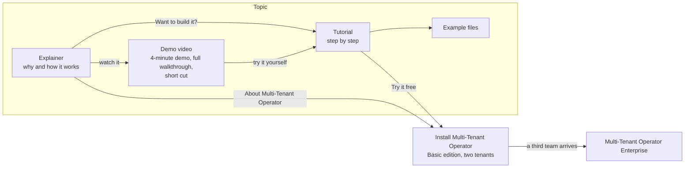
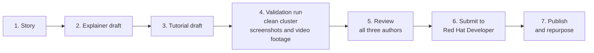

# Content strategy

How this series is planned, made and published. The guidelines for each
piece are in [guidelines/](guidelines/), every new piece starts from a
[template](templates/), and the rules every piece follows are in
[CLAUDE.md](../CLAUDE.md).

## Goals

The series is co-marketing between Stakater and Red Hat, and each piece has
to serve both:

- **Stakater:** more platform teams know Multi-Tenant Operator, try it, and
  adopt it.
- **Red Hat:** a strong, practical story for OpenShift customers, with Red
  Hat products shown at their best.

IBM HashiCorp may tell its own version of a topic, for its own audience.

## Who we write for

| Reader | What they need from us | Where they meet us |
|---|---|---|
| **Platform leads and architects** | Is this worth trying? What problem does it solve, and how does it fit our platform? | The explainer, the short video |
| **Platform engineers** | Show me, then let me do it on my own cluster | The tutorial, the full video walkthrough |
| **Security, Vault and identity owners** | What can this touch, and what stops it going wrong? | The guardrails in each explainer |

## The unit: a topic

Every topic is one question platform teams ask, answered in three pieces
that point to each other:

| Piece | Question it answers | Reader | Length |
|---|---|---|---|
| **Explainer** | Why, and how does it work? | The people deciding | 1,500 to 2,000 words |
| **Tutorial** | How do I build it, step by step? | The engineer trying it | As long as the steps need |
| **Demo video** | Show me it working | Both, and people who don't read | A 3 to 5 minute demo, cut from a full recorded walkthrough, plus a short cut for feeds |

Each topic also has its example files, which readers run, in the topic's
folder.

**The pieces are separate on purpose.** One piece that tries to explain,
teach and demo at once is too long for the person deciding, and too thin
for the person building. Each piece says which of the others to read next.

**The tutorial is the source of truth.** The video is recorded from a real
run of the tutorial, and the explainer's claims match what the tutorial
proves. If a step changes, the tutorial changes first, then the video is
re-recorded.

**Topics also come in pairs when they need different setups.** Topic 1 is
about apps; topic 2 is about people, which needs an identity provider. Each
topic says why it is separate from the one before.

## Topics

| # | Topic | Explainer | Tutorial | Video | Status |
|---|---|---|---|---|---|
| 1 | Tenants carried into Vault Enterprise, for apps | [post 1](../01-tenants-and-vault-enterprise/post.md) | [post 2](../02-try-it-tenants-and-vault-enterprise/post.md) | [plan](../02-try-it-tenants-and-vault-enterprise/video/plan.md) | Tutorial validated on OpenShift 4.22; screenshots partly captured; video planned |
| 2 | One login for tenant members, on OpenShift and Vault | [post 3](../03-one-login-for-tenant-members/post.md) | [post 4](../04-try-it-one-login-for-tenant-members/post.md) | – | Drafts, not yet validated |
| 3 | Tenants and Vault Community: a different isolation model | – | – | – | Idea |
| 4 | The same tenant in more tools: Argo CD, Grafana and others | – | – | – | Idea; extensions run today |

Before starting a topic, check its extension is ready: what the tutorial
shows must already work, and be covered by the extension's tests.

## Channels

| Channel | What goes there | Order |
|---|---|---|
| **Red Hat Developer** | Explainer and tutorial, co-authored | First |
| **Stakater blog** | The same posts, with a canonical link to Red Hat Developer | After Red Hat publishes |
| **YouTube (Stakater)** | The demo, the full walkthrough, and the short cut | Same day as the tutorial |
| **LinkedIn** | The short cut, with a link to the explainer | Same day, then reposted by the authors |
| **IBM HashiCorp** | Their own version of the topic, linking to our tutorial | When they're ready |
| **Sales and demos** | The demo video, and the tutorial cluster as a live demo | Any time after publication |

A topic's explainer and tutorial can go out together or a week apart. The
explainer always links to a tutorial that is already published, or
published the same day.

## How a topic is made

| Stage | What happens | Done when |
|---|---|---|
| **1. Story** | One paragraph: the reader, their problem, what they'll have at the end | The three authors agree on it |
| **2. Explainer draft** | Written to the [explainer guideline](guidelines/explainer.md) | Every claim traces to the extension's tests or docs |
| **3. Tutorial draft** | Written to the [tutorial guideline](guidelines/tutorial.md), with every screenshot planned as a slot and a shot-list row, per the [screenshot guideline](guidelines/screenshots.md) | Every step has its command and expected output; every screenshot names its highlight |
| **4. Validation run** | One run of the tutorial on a clean cluster. The same run captures the screenshots and records the video footage | Every step passes as written; fixes go into the tutorial |
| **5. Review** | A pull request; all three authors approve | Approved, with no open comments |
| **6. Submit** | The Red Hat co-author submits the explainer and tutorial | Accepted, with a publication date |
| **7. Publish and repurpose** | Make the example files public, publish the video, repost on the Stakater blog, post the short cut | Every channel above has its piece |

Doing the screenshots and the video in the validation run is deliberate:
one run, so every image and every second of video matches the steps
exactly.

## Are we following it?

Before a topic moves to review, check:

- [ ] The topic has all three pieces, or a recorded reason why not.
- [ ] Each piece follows its guideline, and its checklist is ticked.
- [ ] The tutorial was run end to end on a clean cluster, and the post says
  which OpenShift version.
- [ ] The explainer links to the tutorial; the tutorial and the video link
  back to the explainer.
- [ ] Every piece ends with the way in: the free Basic edition, the docs,
  and Enterprise for more than two tenants.
- [ ] Nothing claims more than the extension's tests prove.

After publication, we look at what each channel can tell us: page views
from Red Hat Developer, video views and watch time, and LinkedIn
engagement. Which numbers we track, and whether docs links carry campaign
tags, is still open.

## Open decisions

- Which numbers we track after publication, and how.
- Whether Red Hat Developer can embed our videos in the posts.
- Who records the voiceover for each video.
